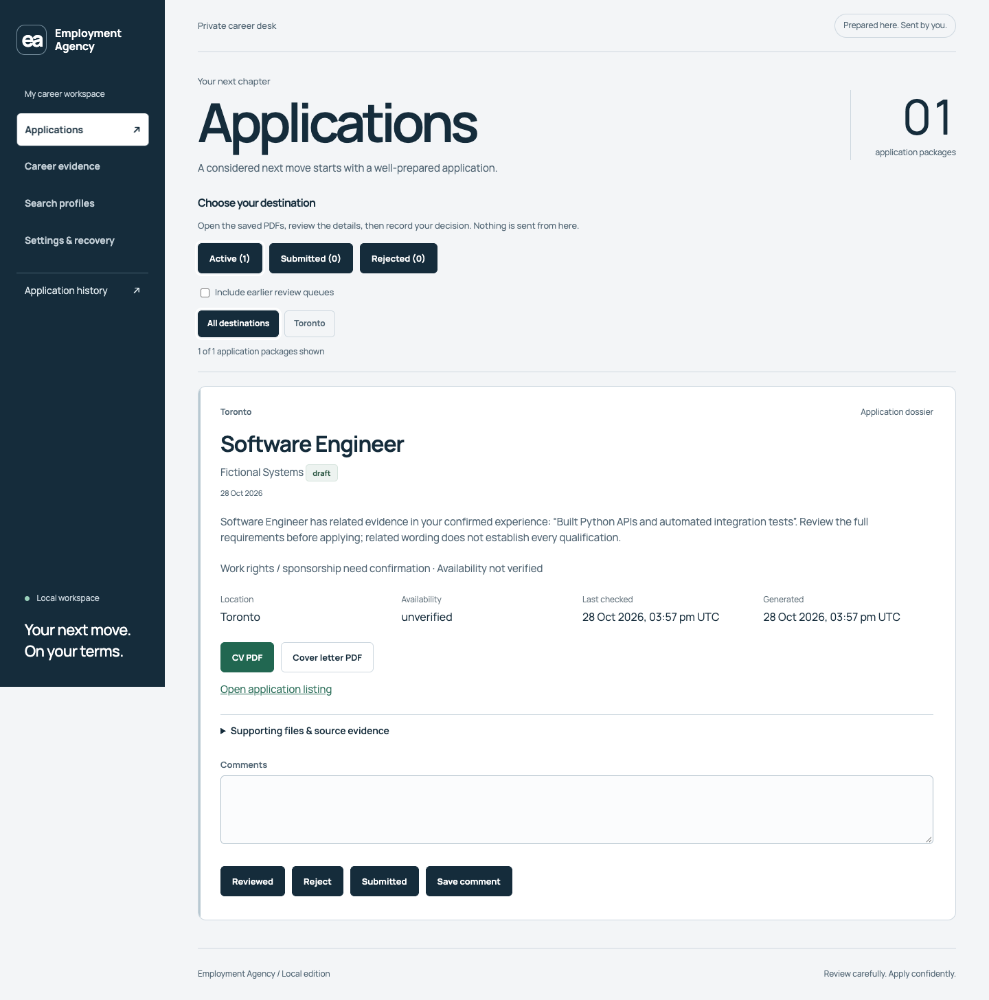

# Employment Agency



A local-first career workspace that turns confirmed experience into job-specific applications you review and submit yourself.

Import your resume, add the experience it leaves out, save search preferences, and prepare a bounded batch of applications. Every match shows its evidence and gaps. Every document uses confirmed facts. By default, your personal files live in an ignored `workspace/` folder alongside the software. You can choose another folder when needed.

## Hosted pilot

[Hosted pilot on Vercel](https://sams-employment-agency.vercel.app) — **invite-only verification pilot**. Google sign-in and dashboard access have been confirmed by the owner; full live storage and account-isolation acceptance is still pending. The hosted experience needs no clone or local installation; your private career data belongs to your cloud account. The local edition remains fully supported and never uploads your workspace automatically.

The hosted build reuses the same matching, document and decision engine. The pilot prepares one application per request, uses no paid AI, and has explicit storage/import limits. Custom LaTeX, local file watching and agent integrations remain local-only. See [setup, limits and verification](docs/hosted-pilot.md).

## Start locally

Requires Python 3.11+ and a modern browser. No API key is needed for local matching and document generation.

```sh
git clone https://github.com/sometheasiekswx/employment-agency.git
cd employment-agency
python3 -m venv .venv
.venv/bin/python -m pip install .
.venv/bin/python -m employment_agency serve
```

Windows PowerShell:

```powershell
py -3 -m venv .venv
.venv\Scripts\python -m pip install .
.venv\Scripts\python -m employment_agency serve
```

Open **http://127.0.0.1:8766** and choose **Use this workspace**. Source installations use `employment-agency/workspace/`, excluded from Git. The app remembers your selection. **Use another folder** is available during setup and under Settings; it is optional. Installed packages outside a source checkout default to `~/EmploymentAgency/workspace`. For an external workspace:

```sh
employment-agency --workspace /path/to/private-workspace serve --port 8766
```

The server only binds to loopback. Do not reverse-proxy it onto a public network. Keep the launcher running while using the UI.

## From experience to applications

1. **Career:** import PDF, DOCX, LaTeX or text. Edit extracted statements, add employer/project and date context where known, then confirm. Add supplemental experience through the same form. Retire contradictory facts; conflicting claim keys prevent use.
2. **Search:** save multiple role/location/seniority/salary profiles. Locations are ordered by priority. Distinguish hard filters from preferences. Choose explicitly whether to include stretch roles and uncertain eligibility.
3. **Discovery:** configure Greenhouse or Lever employer boards, import a structured job URL, paste an advert, or use a connected coding agent. Public-board identifiers come from the employer's board URL. There is no universal web/job-board search in the local adapter; agent handoff supports broader research.
4. **Rank:** inspect requirement evidence, unknown work rights and salary information. Lexical matching is explainable but is not a qualification assessment. Review each requirement; no ATS-pass promise.
5. **Prepare:** run locally without an AI service, or enable OpenAI fact selection. Runs are bounded, resumable and cancellable between operations. Weak matches do not pad the batch, and existing packages are not automatically duplicated. Use a match’s “Prepare a new local version” action for deliberate regeneration. Shorten long facts or select fewer if the two-page resume/one-page letter limit is exceeded.
6. **Review:** read a short evidence-based fit summary and any key gaps, inspect PDF and editable DOCX, and use visible Reviewed, Reject or Submitted buttons. Submitted also confirms review; it records your action without sending anything. Active, Submitted and Rejected sections keep the queue organised. Comments save independently. Available dates and details are shown; empty metadata is hidden while eligibility, availability and document-integrity warnings remain visible. Download an EML draft or open the listing to submit yourself.

## Your files and history

Your workspace contains `state.json` (facts, profiles, jobs, decisions and comments), `workspace.json` (settings), master sources and `applications/City/Company/Job/DD-MM-YYYY/`. Further generations that day use time subfolders. CV and cover-letter links open these exact named files; there is no separate permanent working-package copy. Earlier queue entries are available through **Include earlier review queues**.

Editing your master on disk shows a change notice. Open **Career evidence → Review master changes**, review the diff, contact details and proposed facts, then confirm. Supplementary facts remain; application files are never silently regenerated. The optional trusted LaTeX master renderer supports the documented navy master structure; arbitrary imported layouts are not reproduced. The default PDF/Word renderer requires no LaTeX.

External edits to a generated file are flagged. **Validate edits as a new draft** preserves the verified original and creates a new version for review. PDF-only edits remove stale editable companions. TeX changes can rebuild PDFs with an installed compiler; Word edits require exporting the matching PDF into the same folder before validation. Recovery objects under `.recovery/` retain verified bytes and are included in backup exports; they are not a second live package store. `.runtime/` contains disposable build/export files. Provider permissions live in the local application configuration, outside the workspace.

To migrate a previous workspace or legacy review queue, stop its server first:

```sh
employment-agency migrate-legacy OLD_FOLDER NEW_FOLDER
employment-agency --workspace NEW_FOLDER serve
```

Migration retains original IDs, decisions, comments, source evidence and historical documents, and reports uncertainties in `records/migration.json`. It does not delete the source software or originals. Export and restore the migrated result before retiring an old installation.

## AI is optional

Local mode selects relevant facts and produces structured templates. It is intentionally conservative: it assembles confirmed statements rather than inventing persuasive claims. Agent mode exports a scoped handoff; an agent returns ordered fact IDs through the same validator. See [the agent contract](docs/agents.md).

OpenAI mode uses the Responses API to select fact IDs. Grant consent in Settings for `confirmed_facts` and `job_description`, then set `OPENAI_API_KEY` in the launcher environment. Enter a model and current input/output prices and approve each run budget. No key is stored in workspace data. Paid requests are not used by tests. Budget reservations are conservative calculations using **your supplied rates**, not a provider billing guarantee; also configure account-side limits. Failed/uncertain requests retain their reservation and are not automatically retried.

The app omits contact details and private salary minimums from AI payloads. A coding agent independently given access to your files has its own access/consent boundary. Local-first does not mean cloud AI runs offline.

## Documents and limitations

- Navy and plain styles; editable DOCX and text-based PDF resumes and cover letters.
- Imported TeX is extracted without execution. Enabling your trusted local master layout explicitly allows compilation using an installed `pdflatex`, with shell escape disabled and restricted input/output. Generated Word files are editable content companions; PDF/LaTeX preserve the selected layout.
- PDF fonts currently support Latin-script application text. Unsupported text fails validation instead of silently shipping missing characters. Scanned PDFs need externally supplied OCR text. Arbitrary source layouts are not reproduced.
- Matching is lexical and relies on job metadata. Missing sponsorship, salary, seniority or location data remains unknown. There is no automated immigration/legal advice or universal salary benchmark.
- Listings can close after retrieval. The UI marks stale/unknown evidence and exposes source failures. Recheck before applying.
- EML handling varies by mail client: open/import the draft and inspect its attachments. The app has no send endpoint.

## Recovery and pinned upgrades

```sh
employment-agency --workspace /path/to/private-workspace export backup.zip
employment-agency restore backup.zip /path/to/new-restored-workspace
```

Exports include private data, exclude credentials and clear consent on restore. Existing restore destinations are rejected. A run snapshots the workspace before work starts. Keep an off-device copy yourself; local snapshots alone are not off-device backups.

Pin an installed version or Git commit. Export before upgrading, test a restored copy with the new version, then explicitly switch. Version 0.2 uses schema 2. Older schema-1 workspaces require explicit migration into a new folder; unknown schemas are rejected. No automatic updates or background schedules.

## Development

```sh
python -m pip install .
python -m unittest discover -s tests -v
node --check employment_agency/static/app.js
```

Browser acceptance: start an empty disposable workspace, install/use Playwright separately, then `PLAYWRIGHT_PATH=/path/to/playwright TEST_URL=http://127.0.0.1:8766 node tests/browser.cjs`. The test uses fictional data and changes that workspace. See [verification](docs/verification.md), [security](SECURITY.md) and [dependency notes](docs/dependencies.md).

MIT for original code. This repository includes no personal resumes, mailbox exports or private application history.
