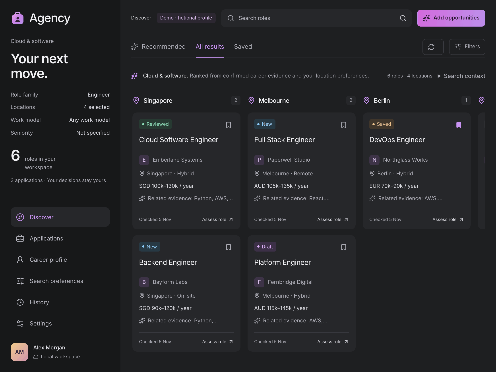
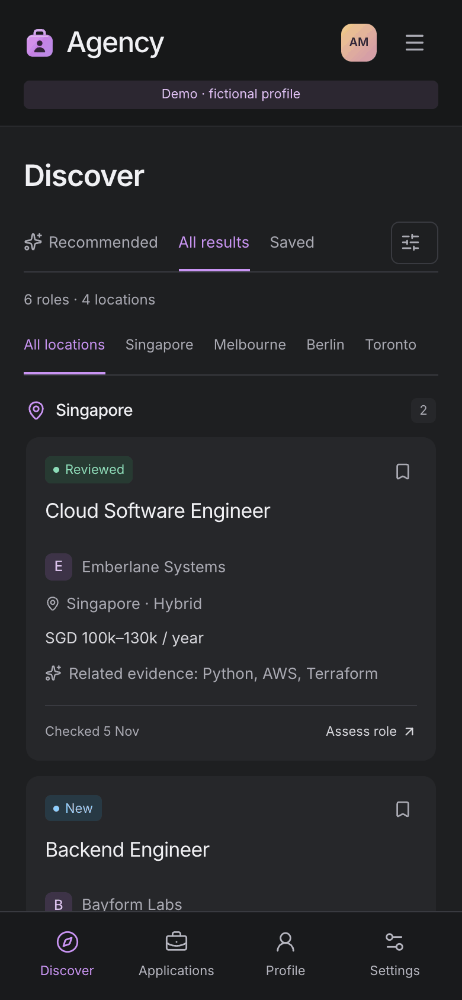
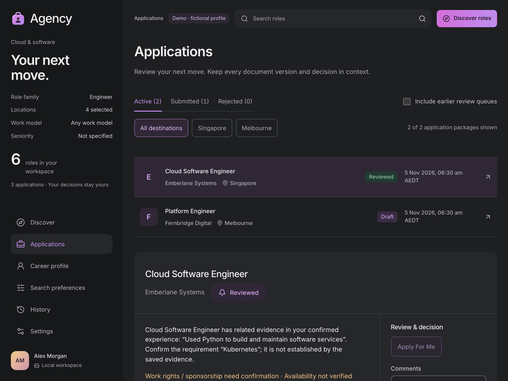

<div align="center">


# Employment Agency

**Your next move, with the evidence in view.**

Find roles in your chosen locations, assess the match and prepare applications you control.

<p>
  <a href="https://github.com/sometheasiekswx/employment-agency/actions/workflows/check.yml"></a>
  <a href="https://github.com/sometheasiekswx/employment-agency/releases"></a>
  <a href="LICENSE"></a>
</p>

[**Explore the live demo →**](https://employment-agency-demo.vercel.app/discover/)

Employer listings · Seven destinations · No sign-in

[The workspace](#the-workspace) · [Run locally](#run-locally) · [Test locally](#test-locally) · [Use your agent](#use-your-agent) · [Documentation](#documentation)

</div>

### Desktop · Keep the shortlist in view

Compare opportunities, choose a profile in Filters and inspect supporting evidence in the same workspace.

<a href="docs/media/discover-review.gif">
  <picture>
    <source media="(prefers-reduced-motion: reduce)" srcset="docs/media/discover-review.png">
    
  </picture>
</a>

[Full desktop GIF](docs/media/discover-review.gif) · [Static preview](docs/media/discover-review.png)

### Mobile · Search, assess, swipe

Search as you type. Swipe anywhere in the partial sheet to expand or close. Keep swiping upward to move straight into reading.

<p align="center">
  <a href="docs/media/mobile-review.gif">
    <picture>
      <source media="(prefers-reduced-motion: reduce)" srcset="docs/media/mobile-review.png">
      
    </picture>
  </a>
</p>

<p align="center">
  <a href="docs/media/mobile-review.gif">Full mobile GIF</a> · <a href="docs/media/mobile-review.png">Static preview</a>
</p>

The recordings use a disposable fictional workspace. In the public demo, view the owner’s public résumé, follow employer listings, explore sample application queues and prepare editable CV and cover-letter drafts. Imported résumés and new drafts stay in the current tab. [Public demo](https://employment-agency-demo.vercel.app/discover/) · [Demo data and capture details](docs/demo.md)

## The workspace

| View                   | What you can do                                                                                             |
| ---------------------- | ----------------------------------------------------------------------------------------------------------- |
| **Opportunities**      | Compare roles, prepare a CV, apply yourself or queue roles for your agent in one role workspace.             |
| **Career profile**     | Import your résumé, confirm experience and retain its sources.                                              |
| **Search preferences** | Choose roles, locations and work models; manage sources and matching.                                       |
| **History**            | Open the exact preserved version of a document.                                                             |
| **Settings**           | Choose Dark, Light or System, select a workspace, manage consent and export a backup.                       |

Assessments keep evidence, gaps and unknowns visible. Live search, loading skeletons, save feedback and recoverable errors support the review flow. Keyboard navigation stays immediate; motion follows your reduced-motion preference.

**Clear the shortlist without losing your records.** Remove a role from Opportunities or Applications and continue with the next one. Open Applications → Removed to review its documents and activity, add a reason or restore it to its previous lists.

**Prepare application → CV → Open application site → I've applied.** The CV opens automatically, and the original job listing stays available alongside documents and activity. In **Jobs**, choose **Apply later** to keep a role in **To apply** through CV preparation. You can apply yourself or select roles in **To apply** to work with an agent. In the local app, [Apply for me](docs/apply-for-me.md) starts a connected agent when a supported runtime and application channel are available. Starting authorizes preparation and submission for the selected roles; missing information or access pauses the run for your help. Saving a role, preparing a draft and copying a handoff confer no submission authority.

## Run locally

<a id="quickstart"></a>

Use live development to see frontend changes as you save. You’ll need **Python 3.11+**, **Node.js 24+** and npm.

### Set up once

If you already cloned the repository, open its folder in Terminal and start at `python3 -m venv .venv`.

```sh
git clone https://github.com/sometheasiekswx/employment-agency.git
cd employment-agency
python3 -m venv .venv
npm --prefix frontend ci --ignore-scripts
npm --prefix frontend run build
.venv/bin/python -m pip install .
```

The initial build gives the Python package its browser assets. On Windows, use `py -3` and `.\.venv\Scripts\python.exe`.

### Start the app

```sh
EA_CONFIG_HOME=.dev-config .venv/bin/python -m employment_agency --workspace workspace-dev init
EA_CONFIG_HOME=.dev-config .venv/bin/python -m employment_agency --workspace workspace-dev dev
```

Open **http://127.0.0.1:3000**. This uses a separate development workspace and settings. Frontend changes appear as you save. Restart after Python changes. Press **Ctrl+C** to stop both servers. [Windows PowerShell and alternate ports](CONTRIBUTING.md#live-frontend-development).

[Use your career workspace or serve the built app](docs/running-locally.md) · [Try sample jobs locally](docs/demo.md#existing-cli-demo) · [Open privately on iPhone via Tailscale](docs/tailscale.md).

The public demo follows checked `main` releases. The v0.7.0 wheel includes the simplified application journey; connected execution requires the optional local setup. [Release downloads](https://github.com/sometheasiekswx/employment-agency/releases) · [Upgrade and recovery](docs/running-locally.md#existing-environments-and-upgrades).

## Test locally

After setup, run these from the software checkout. Stop the dev server before rebuilding.

```sh
npm --prefix frontend run typecheck
npm --prefix frontend run lint
npm --prefix frontend test
npm --prefix frontend run build
.venv/bin/python -m unittest discover -s tests -q
```

The Python checks use the built frontend. For end-to-end checks with fictional data, see [browser test setup](CONTRIBUTING.md#browser-checks).

## Use your agent

Codex, Claude Code or another coding agent can research jobs through the local CLI and API.

### Enable the Codex job research gate

After initializing your private SQLite career workspace, run this from the software checkout with Python 3.11 or later. On Windows, use `py -3` in place of `python3`.

```sh
python3 scripts/setup-codex-job-research-gate.py --workspace "/absolute/path/to/my-career-workspace"
```

Start the app with that workspace. Open the career workspace in local Codex and review and trust the `UserPromptSubmit` and `PreToolUse` project hooks. Codex then requires a successful `GET /api/company-avoid` for that workspace before each supported search or browser call, including on follow-ups. [Setup details and custom ports](docs/agents.md#enable-the-codex-job-research-gate)

### Agent brief

```text
Help me prepare applications using Employment Agency.
Read README.md, CONTRIBUTING.md and docs/agents.md in the software checkout.
My private career workspace is: /absolute/path/to/my-private-workspace

Check existing facts, profiles and decisions before making changes.
Before each job search or follow-up, run the local company-avoid lookup in docs/agents.md.
Research five eligible hiring companies in my chosen locations. Prioritize employers
where I have never applied. Check each accessible official careers source and include
every eligible role, ranked by company, with source URLs, checked dates and unknowns.
Use confirmed experience, preserve document versions and ask about unknowns.
Stop before paid requests, uploads, sending or submission.
Keep personal data out of the public repository and its screenshots.
```

[Agent cookbook, operations and provider consent](docs/agents.md).

## Documentation

[Contributing](CONTRIBUTING.md) · [System design](docs/system-design.md) · [Design system](DESIGN.md) · [Document editing](docs/document-editor.md) · [Security](SECURITY.md) · [Deployment and recovery](docs/public-demo-deployment.md) · [Private hosted pilot](docs/hosted-pilot.md)

<details>
<summary>See document review and preserved history</summary>

<picture>
  <source media="(prefers-reduced-motion: reduce)" srcset="docs/media/application-documents.png">
  
</picture>

[Static document preview](docs/media/application-documents.png) · [Capture provenance](docs/demo.md#current-interface-gifs)

</details>

Original code is [MIT](LICENSE). Third-party components and fonts retain their own licences. [Dependencies and notices](docs/dependencies.md).
