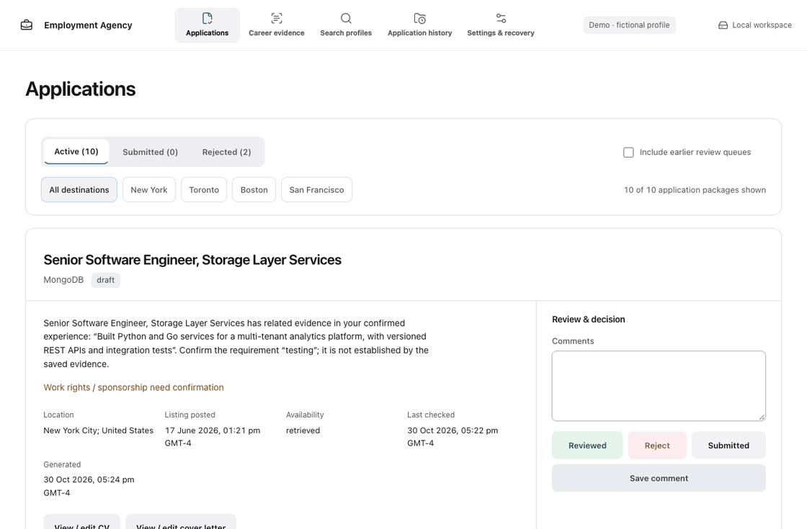

<div align="center">

# Employment Agency

**Your experience. The right roles. Applications you control.**

[](https://github.com/sometheasiekswx/employment-agency/actions/workflows/check.yml)
[](https://github.com/sometheasiekswx/employment-agency/releases)


[Quickstart](#quickstart) · [Try the demo](#try-the-demo) · [Use your agent](#use-your-agent) · [Contribute](#contribute) · [System design](docs/system-design.md)

<picture>
  <source media="(prefers-reduced-motion: reduce)" srcset="docs/preview.png">
  
</picture>

[Static preview](docs/preview.png) · [Demo content and sources](docs/demo.md)

</div>

A local-first application workspace. Import a resume, confirm your experience, define search profiles, compare jobs and prepare PDF/Word documents. Review every version and record your own decisions. **Nothing is submitted or emailed by the app.**

The walkthrough uses **Alex Morgan, a fictional engineer**: 15 sample facts, three search profiles, 13 real employer-board job snapshots and 10 generated packages. The listings include New York, New Jersey/Princeton and Toronto; they are dated examples, not a live availability guarantee. No private resume is used.

## Quickstart

**New installation:** use Python 3.11+ in a new folder. The release wheel includes the interface; Node is not needed.

macOS / Linux:

```sh
python3 -m venv .venv
.venv/bin/python -m pip install https://github.com/sometheasiekswx/employment-agency/releases/download/v0.5.0/employment_agency_local-0.5.0-py3-none-any.whl
.venv/bin/python -m employment_agency serve
```

Windows PowerShell:

```powershell
py -3 -m venv .venv
.venv\Scripts\python -m pip install https://github.com/sometheasiekswx/employment-agency/releases/download/v0.5.0/employment_agency_local-0.5.0-py3-none-any.whl
.venv\Scripts\python -m employment_agency serve
```

Open **http://127.0.0.1:8766**. Keep the terminal running; Ctrl+C stops it. Choose **Save** for the shown workspace or **Open Folder** to select another. No app API key is required.

**Already using the app?** Export a backup and test a restored copy before upgrading. See [upgrade/recovery instructions](docs/running-locally.md#existing-environments-and-upgrades). Installing a release does not automatically upload local data or update a workspace's version pin.

[Hosted pilot](https://sams-employment-agency.vercel.app) is invite-only. Local files and hosted account storage are separate. [Hosted setup and limits](docs/hosted-pilot.md).

## Try the demo

After installation:

```sh
.venv/bin/python -m employment_agency demo demo-workspace --serve
```

Open **http://127.0.0.1:8770**. On Windows, use `.venv\Scripts\python` instead. The command runs offline, creates a **new** folder, generates actual PDFs/DOCX through the application services, and keeps the remembered personal workspace unchanged. Existing destinations are refused.

Reopen without replacing your demo edits:

```sh
.venv/bin/python -m employment_agency demo demo-workspace --open --serve
```

The demo has a fictional source resume, confirmed sample experience, real job metadata/URLs, explicit eligibility unknowns, drafts, review comments and version history. [What is real, what is sample, and how to reproduce the GIF](docs/demo.md).

## Make an application

| Task | Where |
| --- | --- |
| Import PDF, DOCX, TeX or text; review and confirm facts | **Career evidence** |
| Set roles, destinations and hard filters; add jobs or employer boards | **Search profiles** |
| Rank jobs and prepare a bounded batch, or one deliberate version | **Search profiles** |
| Open PDFs/Word files, preview edits, save a new draft, comment or record a decision | **Applications** |
| Find preserved document versions | **Application history** |
| Select a folder, manage provider consent and export a backup | **Settings & recovery** |

Matching explains evidence and gaps; it does not certify qualifications or work rights. Discovery supports configured Greenhouse/Lever boards and structured job URLs; an agent can research broader sources. AI selection is optional. [Providers, consent and budget behavior](docs/agents.md#optional-openai-selection).

## Use your agent

Claude Code, Codex or another coding agent can read the project docs and operate the same CLI/API. No special plugin is required. Copy this into your agent, replace the workspace path, and keep the software checkout separate from your private data:

```text
Help me prepare applications using Employment Agency.

Read README.md, CONTRIBUTING.md and docs/agents.md in the software checkout.
My career workspace is: /absolute/path/to/my-private-workspace

Inspect existing facts, search profiles, applications and decisions before making changes.
Use only confirmed experience. Ask about missing facts and work rights; do not invent them.
Find relevant jobs for my selected profile and retain source URLs and retrieval dates.
Show a ranked shortlist with evidence and gaps before preparing drafts.
Use the app's validated operations to create new versions; preserve submitted files.
Stop before any paid AI request, employer upload, email sending or submission.
Keep my personal data out of the public software repository and its screenshots.
```

For code contributions:

```text
Work on the Employment Agency software checkout, not my private career workspace.
Read PRODUCT.md, DESIGN.md, CONTRIBUTING.md and docs/system-design.md.
Explain the change, preserve existing workflows, and implement a small complete slice.
Use disposable fictional data. Run relevant Python, frontend and browser checks.
Review the diff and show evidence. Do not publish or deploy without my instruction.
```

[Agent cookbook: commands, JSON inputs, running-server access and recovery](docs/agents.md).

## Contribute

React + Next.js + TypeScript handles the interface; Python owns validation, matching, documents and storage. Production serves a static export—there is no second Node server. Start with [CONTRIBUTING.md](CONTRIBUTING.md), [the architecture](docs/system-design.md) and [the design system](DESIGN.md).

```sh
git clone https://github.com/sometheasiekswx/employment-agency.git
cd employment-agency
python3 -m venv .venv
npm --prefix frontend ci --ignore-scripts
npm --prefix frontend run build
.venv/bin/python -m pip install .
.venv/bin/python -m employment_agency demo demo-workspace --serve
```

Source builds require **Node 24+** and npm. If you already cloned, enter the existing software folder using its full path; do not clone inside your private workspace. Stop if a step fails. [Troubleshooting](docs/running-locally.md).

```sh
npm --prefix frontend run typecheck
npm --prefix frontend run lint
npm --prefix frontend test
.venv/bin/python -m unittest discover -s tests -v
npm --prefix frontend run build
npx --prefix frontend playwright install chrome
.venv/bin/python tests/run_browser_checks.py
```

Useful contributions: source adapters, import fidelity, accessible interactions, document rendering and behavior tests. Put shared logic in the app and private data in workspaces. Include the problem, resulting behavior and verification in your PR. [Live frontend development and contribution boundaries](CONTRIBUTING.md#live-frontend-development).

## Your files stay yours

`state.json` holds facts, profiles, jobs and decisions. `applications/City/Company/Job/Date/` holds canonical, versioned documents. Master changes require confirmation. External document edits are validated as a new draft; submitted snapshots remain preserved. [Document editing](docs/document-editor.md) · [Backup, restore and migration](docs/running-locally.md) · [Security](SECURITY.md).

The default renderer produces PDF and editable DOCX without LaTeX. Trusted local TeX is optional. Scanned PDFs need OCR supplied separately; arbitrary layouts are not reproduced; unsupported font/script content fails validation. [System limitations and recovery](docs/system-design.md).

Original code is MIT. React Bits and other third-party components retain their own terms and notices. [Dependencies and licences](docs/dependencies.md).
