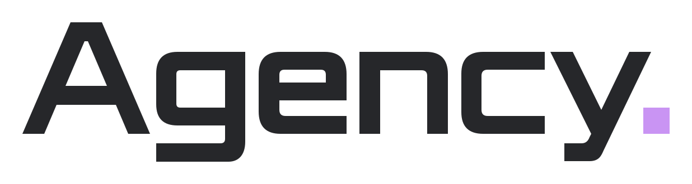
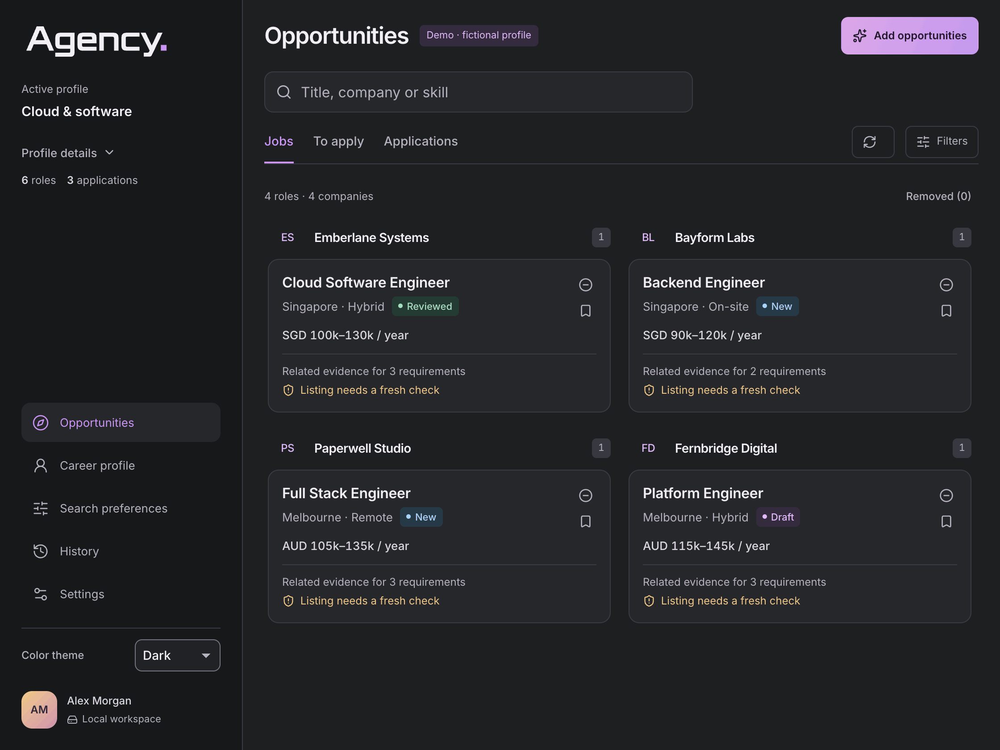
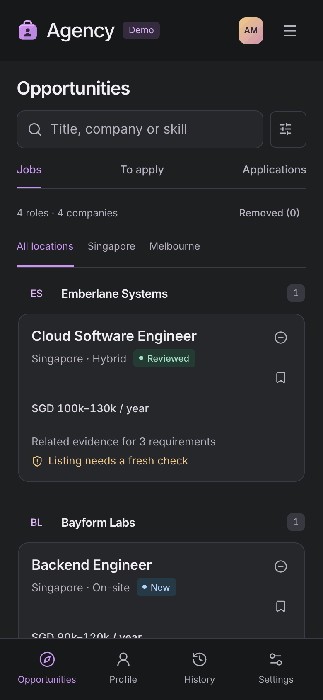
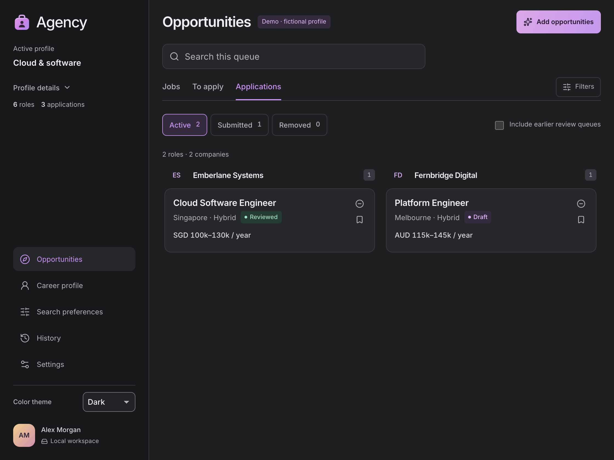

<div align="center">

<picture>
  <source media="(prefers-color-scheme: dark)" srcset="frontend/public/agency-header-on-dark.svg">
  
</picture>

# Employment Agency

**Your next move, with the evidence in view.**

Find roles in your chosen locations, assess the match and prepare applications you control.

<p>
  <a href="https://github.com/sometheasiekswx/employment-agency/actions/workflows/check.yml"></a>
  <a href="https://github.com/sometheasiekswx/employment-agency/releases"></a>
  <a href="LICENSE"></a>
</p>

[**Explore the live demo →**](https://employment-agency-demo.vercel.app/discover/)

Reviewed employer listings · Tab-local drafts · No sign-in

[The workspace](#the-workspace) · [Run locally](#run-locally) · [Test locally](#test-locally) · [Use your agent](#use-your-agent) · [Documentation](#documentation)

</div>

### Desktop · Keep the shortlist in view

Compare roles by company, filter by location and inspect supporting evidence in the same workspace. Company headers show verified logos when available and initials otherwise; opening a role keeps its details beside the board.

<a href="docs/media/discover-review.gif">
  <picture>
    <source media="(prefers-reduced-motion: reduce)" srcset="docs/media/discover-review.png">
    
  </picture>
</a>

[Full desktop GIF](docs/media/discover-review.gif) · [Static preview](docs/media/discover-review.png)

### Mobile · Search, assess, swipe

Search as you type. Swipe anywhere in the partial sheet to expand or close. Keep swiping upward to move straight into reading.

<p align="center">
  <a href="docs/media/mobile-review.gif">
    <picture>
      <source media="(prefers-reduced-motion: reduce)" srcset="docs/media/mobile-review.png">
      
    </picture>
  </a>
</p>

<p align="center">
  <a href="docs/media/mobile-review.gif">Full mobile GIF</a> · <a href="docs/media/mobile-review.png">Static preview</a>
</p>

The recordings use a disposable fictional workspace. In the public demo, view the owner’s public résumé, follow employer listings, explore sample application queues and prepare editable CV and cover-letter drafts. Imported résumés and new drafts stay in the current tab. [Public demo](https://employment-agency-demo.vercel.app/discover/) · [Demo data and capture details](docs/demo.md)

## The workspace

| View                   | What you can do                                                                                             |
| ---------------------- | ----------------------------------------------------------------------------------------------------------- |
| **Opportunities**      | Compare roles, prepare a CV, apply yourself or queue roles for your agent in one role workspace.             |
| **Career profile**     | Import your résumé, confirm experience and retain its sources.                                              |
| **Search preferences** | Choose roles, locations and work models; manage sources and matching.                                       |
| **History**            | Open the exact preserved version of a document.                                                             |
| **Settings**           | Choose Dark, Light or System, select a workspace, manage consent and export a backup.                       |

Assessments keep evidence, gaps and unknowns visible. The company board puts the job title first, with Remove and Apply later stacked beside it and status beside location. Company logos appear in headers and opened details. Work-rights uncertainty stays in the details, with other relevant cautions available in the preview. Keyboard navigation stays immediate; motion follows your reduced-motion preference.

Saving or removing a role keeps the remaining companies in their columns and preserves review order. A new search, filter, profile or responsive column count can start a new layout. Companies with more than two suitable distinct roles can show two evidence-backed highlights while retaining the other roles; these recommendations do not choose applications for you.

**Clear the shortlist without losing your records.** Remove a role from Opportunities or Applications and continue with the next one. Open Applications → Removed to review its documents and activity, add a reason or restore it to its previous lists.

**Prepare application → CV → Open application site → I've applied.** The CV opens automatically, and the original job listing stays available alongside documents and activity. In **Jobs**, choose **Apply later** to keep a role in **To apply** through CV preparation. Open a role to apply yourself or use [Apply for me](docs/apply-for-me.md) when a supported runtime and application channel are available. Starting authorizes preparation and submission for that role. Missing information or access pauses the run for your help. **Copy agent instructions** in **To apply** copies the handoff for the whole pending queue. Saving, preparing a draft and copying leave submission authority with the user.

## Run locally

Start here to use the app for your own job search. Your **software folder** contains the app; your **career workspace** contains your CV, preferences and applications. Keep the career workspace outside this public repository. No provider API key is needed to import a CV, save jobs or prepare documents.

You need Git, **Python 3.11+**, and **Node.js 24+ with npm** to build from source. Check `python3 --version` and `node --version` first. A [prebuilt release wheel](https://github.com/sometheasiekswx/employment-agency/releases) already includes the frontend and needs only Python; see [wheel installation](docs/running-locally.md#install-a-release-wheel). This README describes current `main`; a tagged wheel contains the features at its release, so check its release notes before choosing an installation.

<a id="quickstart"></a>

### Set up once

On macOS or Linux, open Terminal in the parent folder where you want the software. Run each command successfully before continuing. If you already cloned the repository, open its folder and start at `python3 -m venv .venv`.

```sh
git clone https://github.com/sometheasiekswx/employment-agency.git
cd employment-agency
python3 -m venv .venv
npm --prefix frontend ci --ignore-scripts
npm --prefix frontend run build
.venv/bin/python -m pip install .
.venv/bin/python -m employment_agency --workspace "$HOME/Documents/my-career-workspace" init
```

The last command creates your private SQLite career workspace. Replace that path with another **new folder** if you prefer. To open an existing workspace, skip `init` and use its path when starting the app. A Git clone of a SQLite workspace contains its readable snapshot rather than its live database; [restore the snapshot into a new folder](docs/running-locally.md#sqlite-workspaces-and-backups) before opening it.

<details>
<summary>Windows PowerShell commands</summary>

```powershell
git clone https://github.com/sometheasiekswx/employment-agency.git
cd employment-agency
py -3 -m venv .venv
npm --prefix frontend ci --ignore-scripts
npm --prefix frontend run build
.\.venv\Scripts\python.exe -m pip install .
.\.venv\Scripts\python.exe -m employment_agency --workspace "$env:USERPROFILE\Documents\my-career-workspace" init
.\.venv\Scripts\python.exe -m employment_agency --workspace "$env:USERPROFILE\Documents\my-career-workspace" serve
```

Use an installed Python 3.11 or newer. No virtual-environment activation is required.

</details>

### Start the app

Run this from the software folder each time:

```sh
.venv/bin/python -m employment_agency --workspace "$HOME/Documents/my-career-workspace" serve
```

Open **http://127.0.0.1:8766** and choose **Use this workspace** on first launch. Leave the terminal running; **Ctrl+C** stops the app. If port 8766 is busy, append `--port 8767` and open `http://127.0.0.1:8767`. Use `127.0.0.1`, because `localhost` is not accepted by the local server.

### Set up your job search

1. Under **Career profile → Import resume**, choose PDF, DOCX, TXT, Markdown or TeX. Keep **Use this file as my master resume** checked and click **Import for review**. Choose **Review master changes**, review the proposed facts and confirm the ones you want to use. Check the contact details under **Your details**.
2. **Search preferences:** in **Create your first profile**, enter target roles and locations in priority order. Separate locations with commas or new lines. Put Remote or Hybrid in **Work arrangements**. Only record work rights you can confirm, then click **Save profile**.
3. In **Search preferences**, use **Find new jobs** with a public careers URL or configured source, or **Add opportunity** to paste an advert. Open **Jobs** to compare the imported roles and see any preference mismatches. Choose **Apply later** to keep a role in **To apply**.
4. Open a role and choose **Prepare application**. Review its CV and cover letter, then use **Open application site** to apply yourself. Return to **I've applied** to record the submission and its evidence. **Apply for me** starts a configured agent and authorizes submission for the selected roles.

[Full first-application walkthrough](docs/getting-started.md) · [Codex gate setup](#enable-the-codex-job-research-gate) · [Backup and restore](docs/running-locally.md#back-up-without-upgrading)

[Change the app with live development](CONTRIBUTING.md#live-frontend-development) · [Try fictional sample jobs](docs/demo.md#existing-cli-demo) · [Private iPhone access via Tailscale](docs/tailscale.md).

The built app uses the last frontend build. After editing UI source, build again and restart; use the developer workflow for automatic refresh. Installing or rebuilding the software does not upgrade another running installation. [Upgrade and recovery](docs/running-locally.md#existing-environments-and-upgrades)

## Test locally

After setup, run these from the software checkout. Stop the dev server before rebuilding.

```sh
npm --prefix frontend run typecheck
npm --prefix frontend run lint
npm --prefix frontend test
npm --prefix frontend run build
.venv/bin/python -m unittest discover -s tests -q
```

The Python checks use the built frontend. For end-to-end checks with fictional data, see [browser test setup](CONTRIBUTING.md#browser-checks).

## Use your agent

Codex, Claude Code or another coding agent can research jobs through the local CLI and API.

### Enable the Codex job research gate

After initializing your private SQLite career workspace, run this from the software checkout. On Windows, use `.\.venv\Scripts\python.exe` in place of `.venv/bin/python`.

```sh
.venv/bin/python scripts/setup-codex-job-research-gate.py --workspace "$HOME/Documents/my-career-workspace"
```

Keep the app running with that workspace. Open the **career workspace folder** as a local Codex project, then review and trust the `UserPromptSubmit` and `PreToolUse` project hooks. Setup files alone do not enable trusted hooks. Use `--port 8767` here too if you changed the API port.

With trusted hooks enabled, a failed `GET /api/company-avoid` blocks supported search and browser calls, including follow-ups. Setup disables native hosted WebSearch in this project because it bypasses these hooks. This gate is a check for supported tools, not a network sandbox. [Verify setup, tool coverage and recovery](docs/agents.md#enable-the-codex-job-research-gate)

### Agent brief

```text
Help me prepare applications using Employment Agency.
Read README.md, CONTRIBUTING.md and docs/agents.md in the software checkout.
My private career workspace is: /absolute/path/to/my-private-workspace

Check existing facts, profiles and decisions before making changes.
Before each job search or follow-up, run the local company-avoid lookup in docs/agents.md.
Research five eligible hiring companies in my chosen locations. Prioritize employers
where I have never applied. Check each accessible official careers source and include
every eligible role, ranked by company, with source URLs, checked dates and unknowns.
Check each hiring employer with company-research-check before its targeted fetch.
Attempt each company's official logo and retain source evidence; report missing assets.
When a company has more than two suitable distinct roles, save exactly two supported
company highlights and retain the other roles. Run company-research-complete for the
current workspace, profile and checked job IDs before reporting research complete.
Use confirmed experience, preserve document versions and ask about unknowns.
Stop before paid requests, uploads, sending or submission.
Keep personal data out of the public repository and its screenshots.
```

[Agent cookbook, operations and provider consent](docs/agents.md).

## Documentation

[First application](docs/getting-started.md) · [Local setup and troubleshooting](docs/running-locally.md) · [Connected agent setup](docs/apply-for-me.md) · [Contributing](CONTRIBUTING.md) · [System design](docs/system-design.md) · [Design system](DESIGN.md) · [Document editing](docs/document-editor.md) · [Security](SECURITY.md) · [Deployment and recovery](docs/public-demo-deployment.md) · [Private hosted pilot](docs/hosted-pilot.md)

[Documentation index](docs/README.md) separates current guides from dated implementation and verification records. [Changelog](CHANGELOG.md) distinguishes source updates from tagged releases.

<details>
<summary>See document review and preserved history</summary>

<picture>
  <source media="(prefers-reduced-motion: reduce)" srcset="docs/media/application-documents.png">
  
</picture>

[Static document preview](docs/media/application-documents.png) · [Capture provenance](docs/demo.md#current-interface-gifs)

</details>

Original code is [MIT](LICENSE). Third-party components and fonts retain their own licences. [Dependencies and notices](docs/dependencies.md).
