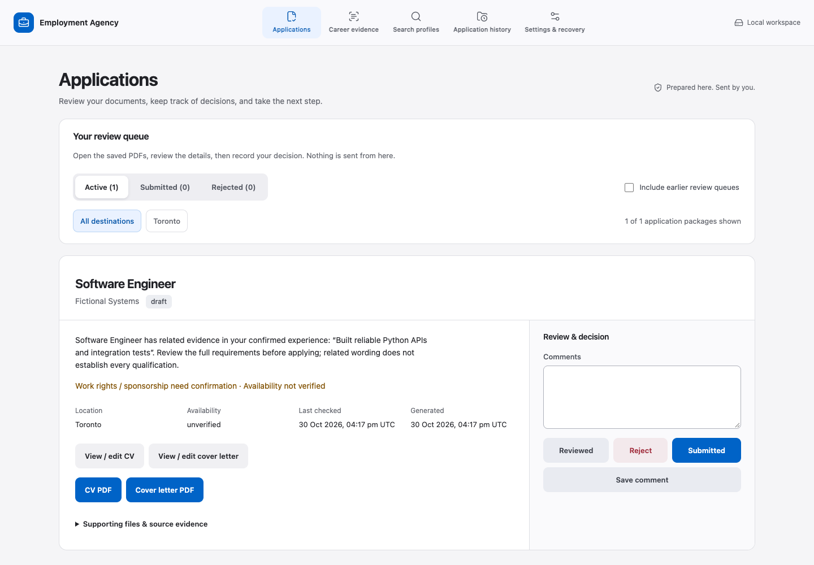
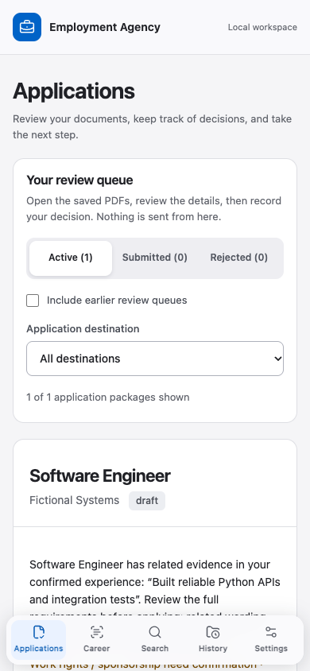

# Interface 0.4 — design and release verification

31 October 2026. Preserve the application and change how it is presented: compact navigation, a clear document/evidence area, adjacent review controls and a familiar Apple-inspired control vocabulary. The owner confirmed all local/hosted workflows and private career files must be preserved, and authorized GitHub publication plus the existing Vercel deployment.

## Implementation

React Bits Dock supplies the proximity/spring mechanism, adapted to labelled Next links with fixed hit targets and the existing draft guard. Keyboard users keep ordinary link behavior; touch and reduced-motion users get static navigation. The desktop navigation becomes a viewport-bottom dock on narrow screens. Native inputs and the established application controls remain; no new control framework or state library was introduced.

The shared CSS now uses system typography, a cool near-white canvas, blue selection/action color, explicit semantic states and consistent spacing. Application cards group original documents/evidence and review/comments into two work areas, collapsing into one column. Empty queues explain the next step. Editor focus, cancellation, version publication and all Python business rules remain in the existing path. `DESIGN.md` and `.impeccable/design.json` document the finished system; development-only strategy stays outside browser artifacts.

No workspace schema or data migration is required. Version 0.4.0 retains schema 2. The private installed build and version pin were not upgraded during testing.

## Failures found and fixed

- A new empty-state label overlapped the accessible navigation name in an existing browser check. The action now says “Add your experience”; existing assertions were preserved.
- Large text exposed a title flex minimum and a metadata grid minimum wider than a narrow panel. Both now wrap at 200% text without horizontal scrolling.
- A mobile capture made immediately after resizing showed a compositor artifact. Captures now reload and wait for stable rendering; viewport geometry checks independently verify the bottom dock.
- The new Axe harness required an explicit browser context. The harness was corrected, without disabling accessibility rules.
- Parallel Next chunk requests intermittently reset connections through the Python 3.12 local server, including startup failures in the editor check. The older default backlog was five. The server now accepts a backlog of 64, and a new parallel asset test verifies complete bytes during a request burst. The full browser suite passed after this fix; errors were not filtered out.
- The existing Vercel deployment of the preceding frontend had failed during dependency bootstrap: setuptools tried to package a frontend before the configured Node build had run. `[tool.uv] package = false` installs runtime dependencies without packaging the source checkout in that phase. Complete pip/setuptools wheels still require built assets. A disposable missing-assets bootstrap proof now runs in Linux CI.
- The finish reviewer required removal of redundant location/generic eyebrow labels above the role title. Location remains in metadata. The same reviewer scored the recaptured correction resolved with `disposition: ship` for that fix.

## Local checks

| Check | Result |
| --- | --- |
| TypeScript, ESLint, production build | Passed |
| Frontend Vitest | 20 passed |
| Python unit/integration suite | 75 passed, including parallel static asset requests |
| Production browser runner | All nine scripts passed, local and fake-hosted workflows |
| Accessibility | Axe WCAG 2/2.1 A/AA checks: five routes at 320/768/1024/1440; no reported violations |
| Interaction/responsive | Actual proximity spring, unchanged link geometry, reduced motion, keyboard and draft cancellation, mobile dock, 200% text passed |
| Hosted dependency bootstrap before assets | Passed with uv in a disposable folder |
| Complete wheel installed outside checkout | Routes/assets/HEAD, generation and submitted export/restore proof |
| Impeccable detector | Ran once on changed UI targets; returned no findings |
| Original private workspace | SHA-256 inventory checked separately before/after; no real workspace served or migrated |

The Python invalid-PDF rejection case prints parser diagnostics; suite result is OK. A clean fake-provider browser result does not prove live OAuth, storage permissions or account deletion. Paid AI and employer submissions were not exercised. Browser and Axe checks do not constitute exhaustive accessibility certification or a full security audit.

## Evidence

Screenshots use fictional records and the production export through the Python server. Capture origin is retained beside them in `evidence/0.4-screenshots-origin.txt`.

## Delivery

The existing Vercel project and domains are the target; account allowlist, provider configuration and deployment protections must remain unchanged. The prior working deployment is retained as rollback. Publication, CI and deployed HTTP/browser observations are recorded after delivery; local checks alone do not establish deployed acceptance. No application data needs to be moved to release this interface.
