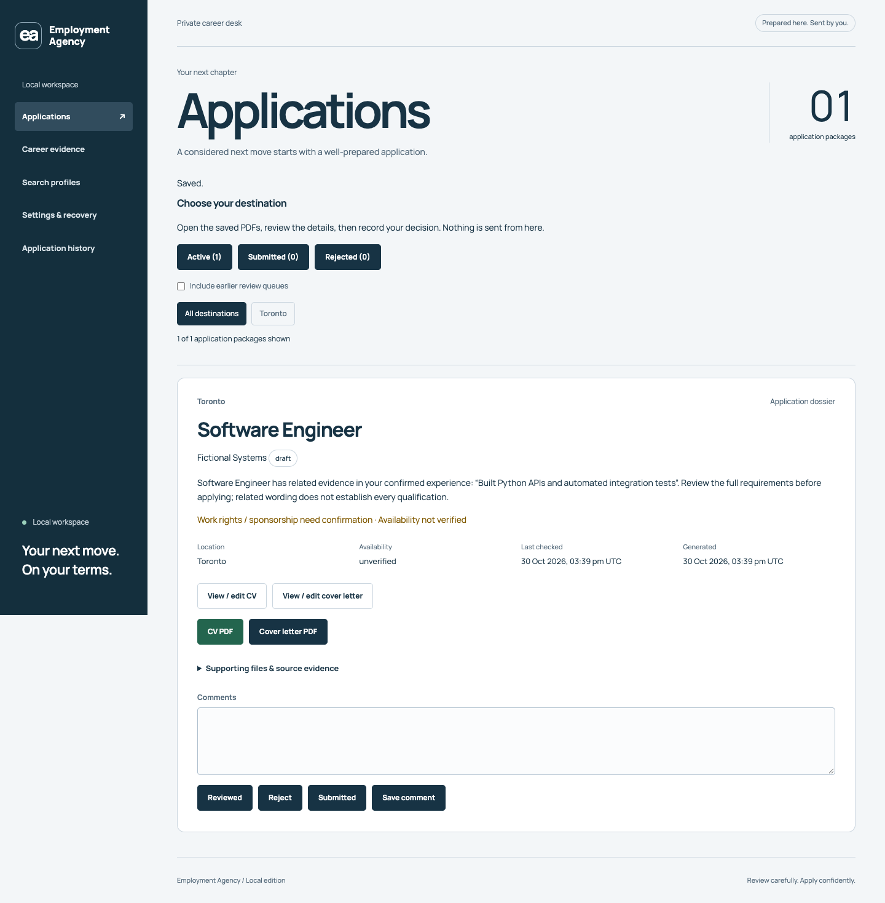
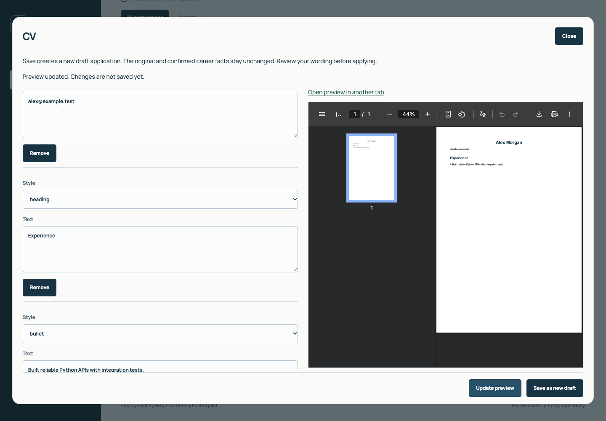

# Local startup verification — 31 October 2026

## Reported failure and correction

The reported error was `cd: no such file or directory: employment-agency`. It occurs before Python, npm or the application starts. A relative `cd` requires the terminal to be in the checkout's parent directory; a failed clone also leaves nothing to enter. The existing software checkout was present and readable. The README now separates first-time cloning from entering an existing checkout, and the [local runbook](running-locally.md) explains full paths, environment recovery, explicit workspace selection and startup errors.

An additional check of the existing checkout reproduced React hydration error 418. Its generated `employment_agency/web/index.html` differed from the Next export: the HTML had been reformatted after building, adding whitespace that changed the parsed DOM. The clean clone did not have this problem. Rebuilding the frontend restored the generated output. A root `.prettierignore` now excludes packaged HTML and other generated output; contributing and troubleshooting guidance explain why those files must not be formatted. This establishes the changed artifact, not which tool or person changed it.

No business logic, state schema, package dependencies, document renderer or data migration was changed. The documentation describes the actual source/runtime distinction and keeps prior virtual environments available during upgrades. `.venv-next/` is now ignored to support that recovery workflow.

## Verification performed

Source baseline: `c86f93058ad0ede9c693a93f3179156c0884d348`, version 0.3.0. Checks ran in a fresh clone with a new Python environment, isolated application configuration and disposable data. The existing checkout was also rebuilt and rechecked using its Python 3.12 environment. The tracked changes are documentation, evidence images and formatter/Git exclusions; the tested application code is unchanged.

Environment: macOS arm64, Python 3.15.2, Node 24.22.0, npm 12.2.0, locally installed Google Chrome through Playwright. These are observed test versions, not new minimum requirements.

| Check | Result |
| --- | --- |
| Fresh clone → Python environment → npm ci with scripts disabled → frontend build → pip install | Passed |
| CLI `python -m employment_agency serve --port 0` with fresh isolated configuration | Passed: HTTP 200, empty default workspace, React setup rendered with Open Folder and Save |
| Existing-checkout CLI after rebuilding packaged frontend | Passed: rendered setup, Open Folder and Save, no hydration/page errors; old installed package preserved |
| Formatter protection | `prettier --file-info employment_agency/web/index.html` reports `ignored: true` |
| Python unittest discovery | 74 passed in both the fresh Python 3.15 environment and existing Python 3.12 environment |
| Frontend TypeScript and ESLint | Passed |
| Frontend Vitest | 20 passed across five test files |
| Production-export browser acceptance runner | All eight scripts passed in the clean clone, then passed again against the rebuilt existing checkout |
| Wheel build and `tests/check_wheel.py` | Passed: installed outside checkout, packaged routes/assets/HEAD, document generation and submitted export/restore |
| npm install audit summary | Zero known vulnerabilities reported for this resolved lockfile snapshot |
| Existing-workspace compatibility | Disposable copy opened; records, facts, profiles, jobs and decisions compared with the source; export/restore file bytes checked |
| Original private workspace preservation | Before/after SHA-256 inventory matched; no real workspace was served or migrated |

The eight browser scripts exercise local and fake-hosted modes, imports/fact confirmation, profiles/jobs/ranking, bounded preparation, comments/decisions, reload persistence, document previews/edits, verified history/downloads, external-edit adoption, master reconciliation, explicit workspace isolation, picker cancellation/errors, retry states, navigation and responsive views. See [the rebuild parity contract](frontend-rebuild.md) and `tests/run_browser_checks.py` for executable scope.

The Python suite emitted existing resource warnings from intentional HTTP-error tests and invalid-PDF parser messages from rejection cases; its final result was OK. The disposable-copy verification harness initially tried to compare the ZIP's `checksums.json` control entry as a restored workspace file. Restore correctly consumes that manifest instead of restoring it. The harness was corrected to compare payload files and application state; application code and test assertions were not weakened.

## Browser evidence

These are screenshots of the built application through the Python HTTP server with fictional records. No personal resume, application or account data is included.

## Review and delivery status

Reviewed the setup instructions against clean-clone and existing-checkout execution, the systems design against Python/React/SQL boundaries, and the existing parity assertions against the reported failure and preservation requirements. Fixed the local generated-HTML issue, verified the formatter exclusion, then repeated affected CLI and browser checks. No unresolved blocking product-code finding was identified in this scope.

Verification includes actual rendered browser behavior and installed-wheel behavior. Hosted tests use an in-memory provider and synthetic session; they do not establish live Google OAuth, deployed Supabase policy correctness or production write/delete behavior. Native folder UI is substituted in automated acceptance; the real desktop dialog was not exercised during this run. Paid AI requests, employer submissions and sending email were not performed. This is not a claim of exhaustive coverage or a full security audit.

Temporary test servers were stopped. The existing installed environment and private version pin were preserved. There was no deployment or automatic private-workspace upgrade. Current documentation/evidence changes remain local for review; this task did not publish them.
