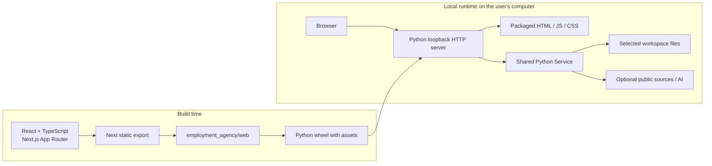
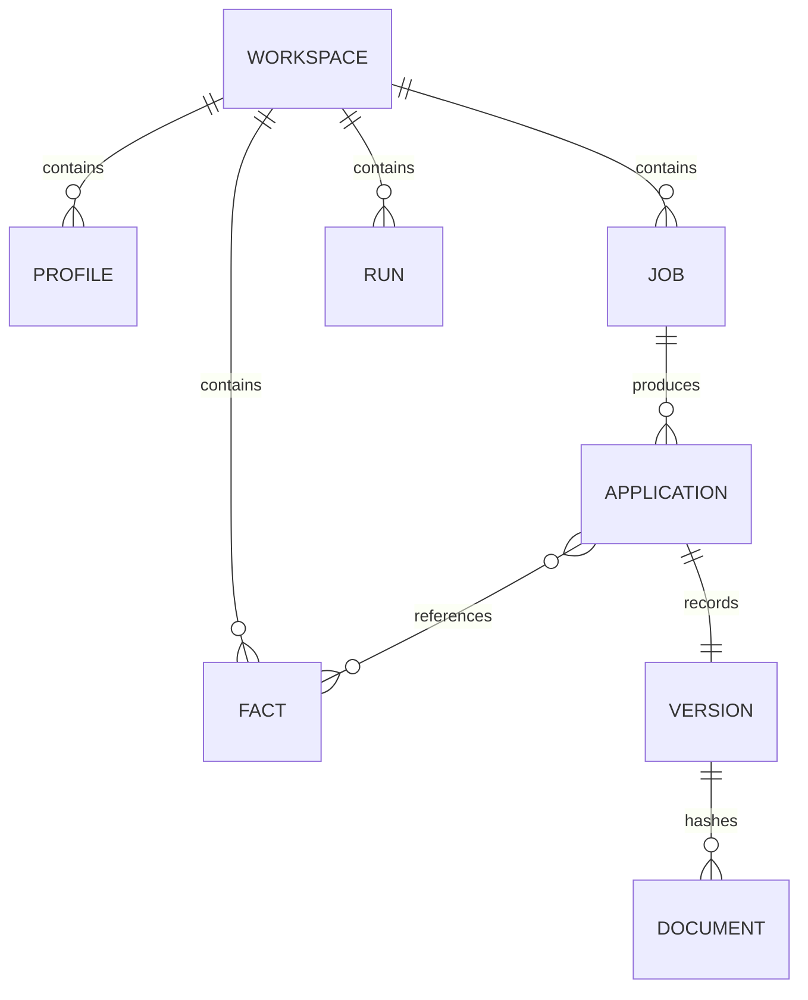
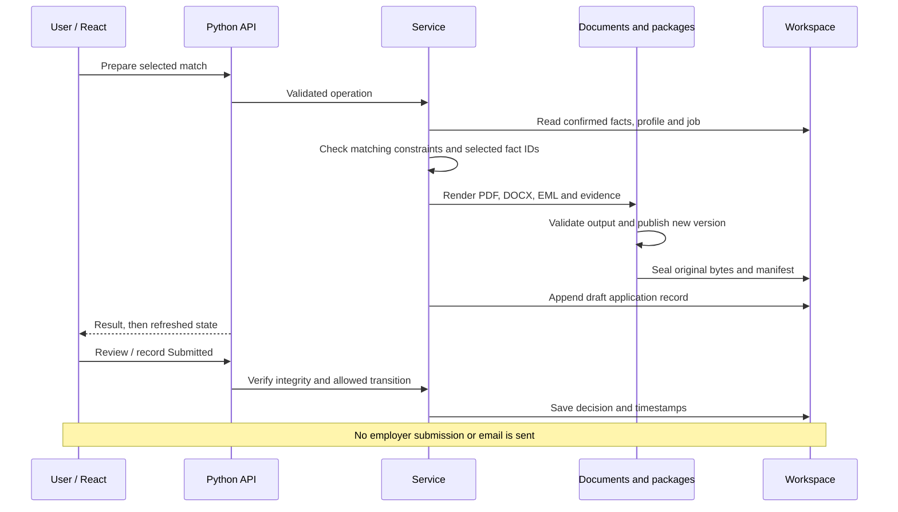
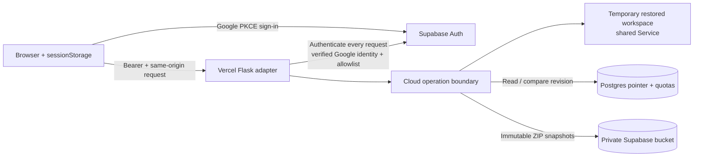

# Employment Agency system design

Source baseline: version 0.6.0, reviewed 31 October 2026. This document describes the implemented local application and hosted pilot. Deployment configuration and live acceptance are separate from source behavior; see [hosted pilot status](hosted-pilot.md), [startup verification](startup-verification.md) and [0.4 redesign verification](redesign-0.4.md).

## Purpose and invariants

The system prepares career applications from user-confirmed evidence. Users import experience, confirm facts, define search profiles, discover or enter jobs, inspect matches, generate documents and record their own review/submission decisions. The application never sends an application or email. An EML is a downloadable draft.

The software repository owns reusable UI, application rules, document rendering and storage. A career workspace owns personal data and generated documents. Workspaces are declarative data; they cannot load executable plugins. Public software distributions must contain no private workspace. See [ADR 0001](adr/0001-shared-application-data-only-workspaces.md).

Confirmed facts retain provenance. Unconfirmed, retired or conflicting facts cannot silently become generated claims. Unknown employer associations, salary and eligibility remain unknown. Submitted snapshots cannot be moved back into a draft status; editing creates another version. Canonical document links resolve the recorded folder and verified bytes, never the newest similarly named file.

## Runtime and build architecture

React owns rendering and browser interactions. Next.js generates HTML, JavaScript and CSS during the build. `frontend/scripts/package-export.mjs` copies the export into the Python package. The wheel includes it; Node is needed for building and frontend development, not for running an installed wheel. There is no Next production server, server action or Next database layer.

Python serves those static files and the API from the same origin. Returning the built HTML from Python is normal: Python is the web server, while React is the interactive UI. Developers author JSX/TSX components instead of manually assembling quoted HTML. The local server uses `ThreadingHTTPServer`; the hosted adapter uses Flask/WSGI. Both invoke the same `Service` and document engine.

The interface uses system typography and a labelled React Bits Dock adaptation over the same state/API layer. Motion handles the small interruptible navigation spring; touch and reduced-motion modes stay static. The local HTTP listener permits a backlog of 64 to accommodate parallel static asset requests on older Python versions. See `DESIGN.md` for the implemented visual system.

The build requires Python 3.11+, Node 24+ and npm. `setup.py` rejects packaging without the frontend and clears stale Python build output before copying the package. Generated web assets are ignored in Git and rebuilt for distribution. Frontend dependencies are locked in `frontend/package-lock.json`; Python dependencies have version ranges in `pyproject.toml` and are resolved at installation, so different install dates can resolve different compatible versions.

Vercel bootstraps Python dependencies before its configured frontend build. `[tool.uv] package = false` keeps that bootstrap from prematurely building the application wheel; the hosted entry imports code from the source checkout. The separate frontend build then creates the packaged web directory. Local wheel distribution continues through pip/setuptools with the complete-asset gate enabled.

## Component ownership

| Component | Responsibility |
| --- | --- |
| `frontend/src/app/` | Routes: applications `/`, career `/career/`, search `/search/`, settings `/settings/`, history `/history/`, and not-found page |
| `frontend/src/features/` | Feature components and forms; no direct workspace filesystem access |
| `frontend/src/components/` | Shell, shared controls, draft navigation protection and workspace state ownership |
| `frontend/src/lib/api.ts`, `auth.ts`, `models.ts` | Explicit API transport, hosted session lifecycle and typed view contracts |
| `cli.py`, `workspaces.py`, `folders.py` | Command entry point, selected location/settings, native folder dialog |
| `server.py`, `web_assets.py` | Local HTTP boundary, workspace switching, safe packaged asset routing and CSP |
| `service.py` | Operation dispatch, validation, orchestration, run lifecycle and application decisions |
| `imports.py`, `master.py` | Resume extraction, master change proposals, explicit reconciliation and trusted local TeX |
| `sources.py`, `matching.py`, `summaries.py` | Public-source retrieval, explainable matching, evidence/gap summaries |
| `documents.py`, `editor.py`, `packages.py`, `history.py` | Render/preview/edit, version publication, integrity checks, history and verified downloads |
| `store.py`, `migrate.py` | Atomic file writes, workspace locking, portable export/restore, explicit legacy migration |
| `providers.py` | Consent-scoped optional AI/agent fact selection and budget reservation |
| `hosted.py`, `cloud.py`, `supabase/migrations/` | Hosted auth boundary, per-request workspace snapshots, private storage, SQL revision/quota controls |

## Local startup and workspace selection

The CLI selects an explicit `--workspace`, otherwise the remembered location in `$EA_CONFIG_HOME/location.json` (default `~/.config/employment-agency`), otherwise a default workspace. A source checkout normally defaults to its ignored `workspace/`; an installed package outside a checkout defaults to `~/EmploymentAgency/workspace`. A missing explicit or remembered directory is currently created as a new workspace: check the selected location if data appears absent. `workspace.lock.json` records a user's accepted installation; the CLI does not automatically enforce or update it.

Opening a workspace acquires an operating-system advisory lock in `.lock`. Another process cannot open that workspace through this application until the first closes. A thread lock serializes file-state edits inside the process. Startup initializes a new schema-2 state when missing and pauses interrupted runs. It does not accept unknown schemas; serving schema 1 requires explicit migration first. Opening is therefore a write operation, which is why upgrade checks should use a restored copy.

The server binds only `127.0.0.1`. A request gate coordinates operations with workspace switching. Switching is blocked during an active run. A replacement workspace is opened and validated before the previous one is closed; the remembered location is updated and the request token rotated. A native folder dialog runs without holding the request gate, so state reads remain available. Only one chooser may run; its result is rejected if another switch occurred while it was open.

The UI displays location and Save. Open Folder asks the operating system to select a folder: macOS AppleScript, Windows PowerShell/Forms, Linux Zenity or KDialog. Cancellation keeps the selection. Existing workspace folders are opened; an empty folder may become a new workspace. Arbitrary nonempty folders without workspace state are rejected by the picker flow.

## Browser state and API contracts

The browser first requests `/api/runtime`. Local mode uses a local `ApiClient`; hosted mode initializes Google/Supabase authentication after fetching public configuration. `WorkspaceProvider` owns the current server state and refresh sequence. Feature forms own drafts; draft protection prevents navigation from silently discarding unsaved edits. Local state polls every eight seconds while the tab is visible, or two seconds during a run. Hosted idle state does not poll continuously.

The API is operation-oriented JSON rather than a general CRUD/REST model. `Service` validates operation inputs and is the authority for durable changes. TypeScript types help development but do not replace Python input validation.

| Boundary | Contract |
| --- | --- |
| `GET /api/runtime` | `{mode: "local"}` or `{mode: "hosted"}` |
| `GET /api/state` | `{state, token}`; state includes derived workspace/master metadata, warnings and integrity results |
| `POST /api/{operation}` | JSON object; success generally `{result}`; error `{error}` with non-2xx status |
| Local mutations | Exact `Host`, permitted `Origin`, `application/json`, current `X-Workspace-Token`; body at most 15 MiB |
| Hosted requests | Bearer identity on every protected request; POST origin equals configured public HTTPS origin; request limit 3 MiB |
| Local document routes | `/files/{application-id}/{role}` resolves the recorded mapping and redirects to verified `/history/files/{version-id}/{filename}` |
| Hosted document routes | Authenticated POST `file` or `history-file` returns binary bytes; browser creates a temporary download/preview URL |
| Exports | Local action returns a download path under `.runtime/exports/` (no automatic cleanup guarantee); hosted action streams a private ZIP |

Operations cover identity, import, fact/confirm/retire, profiles, jobs/URL/source/discovery, rank, consent, master proposal/acceptance, prepare/run/resume/cancel, document preview/save, external-edit adoption, history, review/comments and export. Local workspace-open/create/browse are handled by the HTTP adapter. Hosted deliberately allows a smaller set; it rejects local folder access, agent/paid AI runs and custom TeX execution.

The client tracks request generations. A response issued before a workspace change cannot overwrite the newly selected workspace's UI state. The server token also invalidates stale mutations. Drafts and profile selection reset at the workspace boundary.

## Durable local model

These are logical relationships in JSON and files, not database-enforced foreign keys. Imported historical versions may exist in the history catalogue without a current application record. The service validates relevant references at operation boundaries.

| Location | Contents and authority |
| --- | --- |
| `state.json` (schema 2) | Identity, facts and provenance/confirmation, profiles, jobs, sources, runs, applications, comments, events and decision timestamps |
| `workspace.json` (settings schema 1) | Master path, timezone, layout/page limits, location preferences and setup status |
| `master/`, `imports/`, research and records | Source documents and retained supporting evidence; imported content is untrusted data |
| `applications/City/Company/Job/DD-MM-YYYY[/Time]/` | Canonical generated documents and `version.json`; regeneration creates a distinct folder |
| `version.json` | Job context, source/time, logical-role-to-filename map and SHA-256 for each file |
| `.recovery/objects/{sha256}` | Content-addressed verified original bytes |
| `.recovery/versions/`, `.recovery/index.json` | Verified manifests and folder-to-manifest associations |
| `.runtime/` | Disposable exports and build/preview artifacts; excluded from backups/Git |
| External configuration directory | Remembered workspace and path-keyed provider permissions; credentials remain in launcher environment |

Schema-2 `state.json` retains an empty consent field; live consent is read from external permission files. A transferred workspace does not carry transferable authority. API-only fields such as `_workspace`, `_master`, fit summaries and file-change warnings are derived rather than independently persisted.

Individual file writes use a temporary file in the same directory, flush/fsync, then `os.replace`. Document publication stages a complete folder and renames it into place, then seals recovery bytes and appends application state. **The entire operation is not a database transaction across all files.** A crash between stages can leave a version discoverable in history without its queue record. Recovery manifests, original bytes and explicit adoption preserve inspectable evidence; off-device backups are still required. External editors do not honor the application's locks.

## Main workflows

### Import, master reconciliation and matching

PDF/DOCX/text/TeX imports extract candidate statements; importing TeX does not execute it. User confirmation makes facts available. Master change detection compares the source digest with the accepted digest. Proposal review includes contact/fact differences; accepting requires the expected digest and explicit confirmation. Supplemental facts retain their provenance and are not discarded simply because the master omits them.

Jobs come from manual entry, supported public employer boards (Greenhouse/Lever), structured job URLs or an agent handoff. Public HTTPS retrieval validates DNS addresses, rejects private/reserved destinations and credentials, pins the connection address, limits redirects and bounds response size. HTML/advert content is evidence, never executable instructions.

Matching compares confirmed available facts to job requirements and profile hard filters/preferences. Results expose evidence, gaps, unknowns and exclusions. Unknown eligibility or stretch inclusion requires the user's profile choice. Lexical matching does not establish professional qualification, visa eligibility, current vacancy status or ATS acceptance.

### Prepare, edit and record decisions

The standard renderer uses ReportLab and python-docx. The trusted local master renderer can invoke installed `pdflatex` with shell escape disabled and constrained paths. Output page limits and extractable PDF text are checked. Unsupported font/script content fails rather than silently producing missing characters. Arbitrary source layouts and scanned-PDF OCR are not supported automatically.

Editor preview does not publish. Saving publishes a new draft; previous canonical documents remain. External edits are detected against recovery hashes and block approval/download as verified content. Explicit adoption validates the edited PDFs/companions, publishes a new draft and restores the original verified version. A changed Word file requires a matching exported PDF; PDF-only edits drop stale editable companions. History reads verify the exact version rather than falling back to another folder.

Comments can save independently of decision changes. Submitted status also establishes review, records the user's own action and cannot be reversed into a draft. New content belongs in another version.

### Bounded local runs and optional providers

Local preparation needs no remote AI. A local worker thread processes a bounded candidate list, snapshots the workspace before the run, persists progress, and supports cancellation between operations and explicit resume. Existing packages do not silently get duplicated to fill a batch. Restart pauses interrupted running records.

OpenAI is an optional fact-ID selector, not an unrestricted author. It requires current consent for confirmed facts and job descriptions, a launcher key, selected model/rates and an approved run budget. Payloads omit contact details and private salary minima. Selection must contain valid confirmed fact IDs. Cost is reserved before a request using user-supplied rates; uncertain charges retain reservation and are not automatically retried. Cancellation cannot undo an already issued remote request. The agent path exports a scoped handoff and validates returned selection through the same rules; an independently authorized agent's file access is a separate boundary.

## Hosted pilot architecture

There is no automatic local/cloud synchronization. A hosted request authenticates the user through Supabase, verifies confirmed Google identity and the operator allowlist, then uses a server-only service-role key for owner-scoped storage. Only public provider URL/anon key reach the frontend. The tab session lives in `sessionStorage`; the service-role key never belongs there. A pilot enablement gate and provider configuration fail closed.

The cloud adapter downloads the current snapshot, validates archive limits/integrity and restores it into a per-request temporary directory. It forces hosted-safe settings and invokes the shared service. Read-only operations do not consume save quota. A mutation acquires an exclusive owner storage lock, rechecks account existence, uploads a new immutable ZIP, and calls a SQL function with the expected revision. The SQL transaction advances the pointer only when revision, quota and deletion checks pass. Conflicts preserve the previous committed workspace. An ambiguous commit checks the published pointer before cleaning up a possibly unused snapshot.

Postgres stores `owner`, `revision`, `object_key`, cumulative `bytes` and `deleting`; it does not currently hold individual fact/application rows. Table RLS and lack of direct client grants keep access behind the server boundary. The bucket is private with no client policies. Those source rules still need live-provider verification after configuration changes.

Pilot bounds: imports approximately 2 MB; snapshots 3 MiB compressed, 30 MiB expanded and 5,000 archive entries; 500 facts, 300 jobs and 25 application records; cumulative uploaded snapshots 50 MiB / 250 revisions per owner. There is no durable background worker. Each hosted generation prepares one package in a request. Full-snapshot transfer and retained revisions deliberately constrain scale.

Deletion requires typed `DELETE`, marks the account deleting, removes owned snapshots and deletes the Auth user. Interrupted deletion can be retried; normal access is blocked meanwhile. A crashed mutation can leave an operation lock. Operators must confirm the invocation ended before removing that exact lock; the code does not automatically steal it. See [hosted operations](hosted-pilot.md).

## Security and failure boundaries

Local mode trusts the user's machine account and filesystem; it has no separate user login or at-rest encryption. Loopback binding, exact Host/Origin/token checks, JSON-only mutations, safe relative paths and symlink rejection protect the HTTP boundary. Do not expose it through a public reverse proxy. Native picker commands are fixed argument arrays, never user-controlled shell commands.

Both adapters restrict assets to the packaged web root and use CSP hashes for the exact generated inline bootstrap scripts. They do not enable arbitrary inline JavaScript. Private files are served through scoped verified routes, not a general filesystem browser. Secrets, sessions, config permissions and disposable caches are excluded from source distributions/workspace exports as applicable. Backups themselves contain private data and are not encrypted by the application.

| Failure | Implemented response / recovery |
| --- | --- |
| Terminal cannot enter checkout | Correct its path; no application process has started |
| Missing frontend build | Packaging fails or HTTP reports missing assets; rebuild before installation |
| Port occupied / workspace locked | Startup fails; stop the existing process or select another port, never delete an active lock |
| Unknown schema | Reject; use compatible release or explicit migration into a new folder |
| Interrupted run | Mark paused; retain progress and uncertain billing evidence, resume explicitly |
| Damaged/externally edited document | Show integrity warning and block verification; validate edits as a new version or recover verified bytes |
| Changed master | Show proposal; do not silently confirm or regenerate applications |
| Cloud conflict/quota/provider failure | Retain last committed pointer; reload, export or operator recovery as appropriate |
| Lost disk / deleted workspace | Restore an external backup; local recovery objects on the same disk are insufficient |

## Backup, migration and operation

Export writes a new ZIP with workspace files and SHA-256 manifest, excluding executable/runtime/secret-like material and clearing transferable consent. Restore rejects an existing destination, unsafe paths, duplicate paths, unsupported schema and checksum failures before publishing a restored directory. It writes payloads as regular files rather than recreating archive symlinks. Legacy migration copies into a new workspace, retains decision/source history and reports uncertainty; it does not delete the source.

For upgrades: stop the old server, export using the accepted installation, restore to a new folder, install the new build in a separate environment, verify the copy and deliberately switch. Preserve the previous environment and backup until accepted. Do not regenerate submitted documents merely to test an upgrade. See [local runbook](running-locally.md).

The local app logs its listening address but suppresses routine HTTP logs. Hosted errors return bounded messages instead of provider bodies or credentials. There is no implemented centralized monitoring, high-availability local store, full audit-log immutability or guaranteed multi-file transaction. Operational evidence comes from health/state reads, recorded events/decisions, integrity warnings, backup checks and automated tests.

## Verification and expansion seams

Python tests cover business workflows, storage/recovery, imports, matching, consent/budget boundaries, edits, migration, local HTTP and hosted isolation/conflicts using fake providers. Frontend unit tests cover transport/session/state behavior. Browser acceptance runs built production assets against disposable local and hosted fixtures and checks UI flows, failures, navigation and responsive layout. Wheel proof installs outside the checkout and checks assets, document generation and submitted backup/restore. These checks complement each other; fake providers do not establish real OAuth/RLS or employer-site availability.

To add a feature, first define its shared `Service` validation and persistence behavior, then expose it through the allowed adapter(s), update the typed API/view model, and add UI to its feature folder. Preserve schema and document versions or provide explicit migration. To add a source, reuse the bounded public-source fetcher. To change rendering, keep package validation and immutable version publication in the path.

A local database is a future option if measurements show that whole-state reads, serialized writes or JSON relationship validation are limiting. SQLite could add transactional metadata and indexes while retaining canonical documents on disk; adopting it would require versioned migration, portable backup compatibility and restored-copy acceptance. A multi-user hosted service would likely need normalized metadata, incremental document objects and durable jobs instead of whole ZIP snapshots. Neither migration is implemented or required to run the current single-user local app.

## Isolated demonstrations

The local `demo` command creates a new marked workspace using the same import, master reconciliation, fact confirmation, profile, job, package and review operations. It reads bundled fictional resume data and public job snapshots offline. Creation is staged; existing destinations are refused. `--open` validates demo/config/state markers before opening a store. `--serve` isolates application configuration beneath the demo runtime folder, preserving the remembered personal workspace. Demo consent is never granted, real submissions are never seeded, and snapshot availability is dated rather than guaranteed. The extra optional `demo` settings flag defaults to false for existing schema-1 settings; career state remains schema 2. See [demo sources and reproduction](demo.md).
