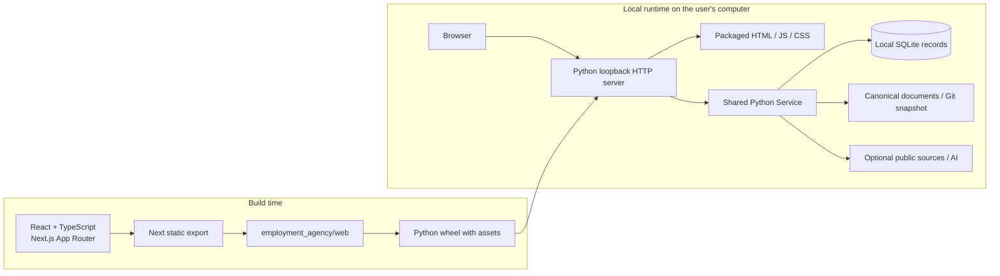
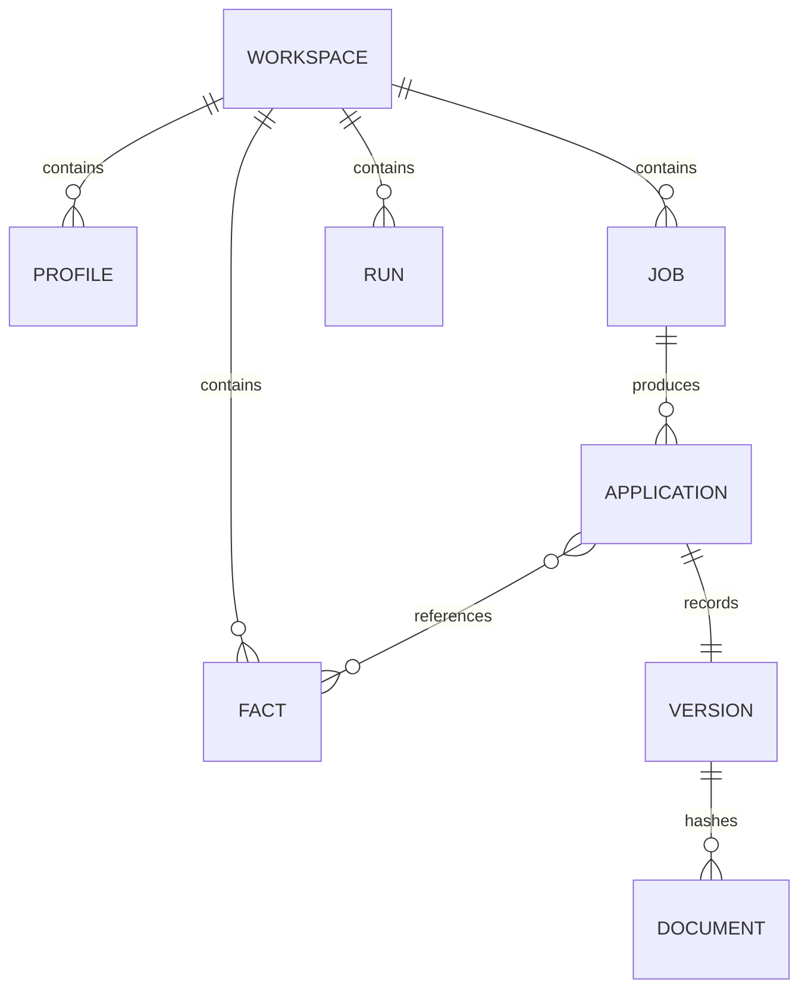
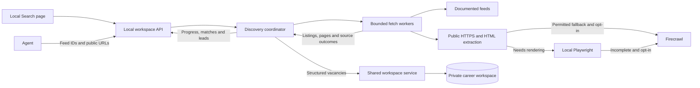
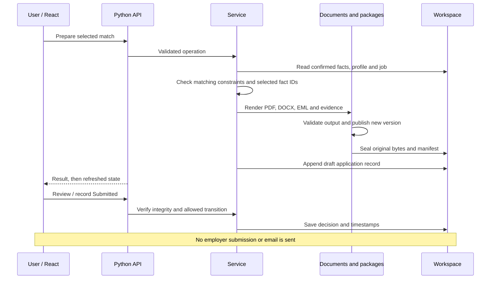
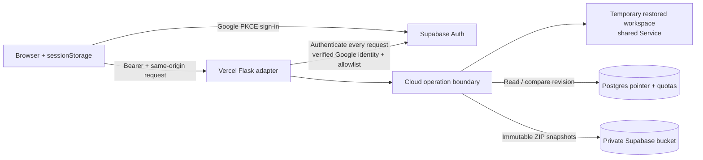

# Employment Agency system design

Source baseline: current `main`, reviewed 16 November 2026. Package metadata is 0.7.0; source changes after the tagged 0.7.0 wheel include SQLite schema 7 and the current company board. This document describes implemented source behavior. An installed wheel or hosted deployment has its own accepted revision; see [local installation and recovery](running-locally.md), [hosted pilot status](hosted-pilot.md) and [public-demo deployment](public-demo-deployment.md).

## Purpose and invariants

The system prepares career applications from user-confirmed evidence. Users import experience, confirm facts, define search profiles, discover or enter jobs, inspect matches and generate documents. Self-apply records the user's completed submission. In the local SQLite app, starting **Apply for me** authorizes a supported connected agent to prepare and submit for the named role. Draft generation, an EML download, an Apply later choice and a manual submission record do not send anything. Hosted and public-demo modes do not execute applications. See [connected applications](apply-for-me.md).

The software repository owns reusable UI, application rules, document rendering and storage. A career workspace owns personal data and generated documents. Workspaces are declarative data; they cannot load executable plugins. Public software distributions must contain no private workspace. See [ADR 0001](adr/0001-shared-application-data-only-workspaces.md).

Confirmed facts retain provenance. Unconfirmed, retired or conflicting facts cannot silently become generated claims. Unknown employer associations, salary and eligibility remain unknown. Submitted snapshots cannot be moved back into a draft status; editing creates another version. Canonical document links resolve the recorded folder and verified bytes, never the newest similarly named file.

## Runtime and build architecture

React owns rendering and browser interactions. Next.js generates HTML, JavaScript and CSS during the build. `frontend/scripts/package-export.mjs` copies the export into the Python package. The wheel includes it; Node is needed for building and frontend development, not for running an installed wheel. There is no Next production server, server action or Next database layer.

Python serves those static files and the API from the same origin. Returning the built HTML from Python is normal: Python is the web server, while React is the interactive UI. Developers author JSX/TSX components instead of manually assembling quoted HTML. The local server uses `ThreadingHTTPServer`; the hosted adapter uses Flask/WSGI. Both invoke the same `Service` and document engine.

The interface uses locally hosted Inter, a desktop sidebar and a labelled mobile Dock over the same state/API layer. Motion supports navigation, role details and stable board updates; reduced-motion settings suppress decorative movement. The local HTTP listener permits a backlog of 64 to accommodate parallel static asset requests on older Python versions. See [DESIGN.md](../DESIGN.md) for the implemented visual system.

The build requires Python 3.11+, Node 24+ and npm. `setup.py` rejects packaging without the frontend and clears stale Python build output before copying the package. Generated web assets are ignored in Git and rebuilt for distribution. Frontend dependencies are locked in `frontend/package-lock.json`; Python dependencies have version ranges in `pyproject.toml` and are resolved at installation, so different install dates can resolve different compatible versions.

Vercel bootstraps Python dependencies before its configured frontend build. `[tool.uv] package = false` keeps that bootstrap from prematurely building the application wheel; the hosted entry imports code from the source checkout. The separate frontend build then creates the packaged web directory. Local wheel distribution continues through pip/setuptools with the complete-asset gate enabled.

## Component ownership

| Component | Responsibility |
| --- | --- |
| `frontend/src/app/` | Opportunities `/discover/`, career `/career/`, search `/search/`, settings `/settings/`, history `/history/`; `/` preserves legacy application links through a redirect |
| `frontend/src/features/` | Feature components and forms; no direct workspace filesystem access |
| `frontend/src/components/` | Shell, shared controls, draft navigation protection and workspace state ownership |
| `frontend/src/lib/api.ts`, `auth.ts`, `models.ts` | Explicit API transport, hosted session lifecycle and typed view contracts |
| `cli.py`, `workspaces.py`, `folders.py` | Command entry point, selected location/settings, native folder dialog |
| `server.py`, `web_assets.py` | Local HTTP boundary, workspace switching, safe packaged asset routing and CSP |
| `service.py` | Operation dispatch, validation, orchestration, run lifecycle and application decisions |
| `imports.py`, `master.py` | Resume extraction, master change proposals, explicit reconciliation and trusted local TeX |
| `sources.py`, `matching.py`, `summaries.py` | Public-source retrieval, explainable matching, evidence/gap summaries |
| `documents.py`, `editor.py`, `packages.py`, `history.py` | Render/preview/edit, version publication, integrity checks, history and verified downloads |
| `store.py`, `sqlite_workspace.py`, `migrate.py` | Workspace locking, transactional SQLite records and queue indexes, readable snapshots, portable export/restore and explicit legacy migration |
| `companies.py`, `company_best_matches.py`, `company_logos.py` | Verified employer identity, company allowance/cooldown, reviewed recommendations and sourced logo assets |
| `application_context.py`, `agent_execution.py`, `agent_website.py`, `codex_runtime.py` | Exact role/document context, scoped connected-agent execution, channel checks and durable outcomes |
| `providers.py` | Consent-scoped optional AI/agent fact selection and budget reservation |
| `hosted.py`, `cloud.py`, `supabase/migrations/` | Hosted auth boundary, per-request workspace snapshots, private storage, SQL revision/quota controls |
| `public_catalog.py`, `public_preview.py`, `frontend/src/lib/public-preview.ts`, `public-listings.ts`, `demo-*.ts` | Reviewed public catalog, sample dataset and browser-only public-demo interactions |

## Local startup and workspace selection

The CLI selects an explicit `--workspace`, otherwise the remembered location in `$EA_CONFIG_HOME/location.json` (default `~/.config/employment-agency`), otherwise a default workspace. A source checkout normally defaults to its ignored `workspace/`. An installed package outside a checkout defaults to `~/EmploymentAgency/workspace`. Use `--workspace PATH init` to create a workspace at an explicit path. Startup remembers the selected folder after binding its port. `workspace.lock.json` records a user's accepted installation.

Opening a workspace acquires an operating-system advisory lock in `.lock`. Another process cannot open that workspace through this application until the first closes. A thread lock serializes state edits inside the process. `init` and new local workspace creation use SQLite; existing schema-2 JSON workspaces remain readable without automatic conversion. Current SQLite database schema is 7, while the internal service state retains schema 2 and portable snapshots use schema 3. Opening can migrate an older supported database, publish its snapshot and pause interrupted runs, so upgrade checks must use a restored copy. Unknown/newer schemas are rejected. A Git-only snapshot with no database must be restored explicitly; it is not mistaken for an empty workspace.

The server binds only `127.0.0.1`. A request gate coordinates operations with workspace switching. Switching is refused during preparation, delivery or connected application work; a successful switch closes discovery. The server validates a replacement and saves the selection before changing the active workspace and rotating the token. If saving the selection fails, the previous workspace and token stay active. A native folder dialog runs without holding the request gate, so state reads remain available. The server accepts one chooser at a time and rejects a result if a workspace switch occurred while it was open.

Open Folder uses the native chooser on macOS, Windows, or Linux. Cancellation keeps the selection. Select an existing workspace, an empty folder, or a new Git repository. Use `init` when deliberately initializing a folder that already holds other files.

## Browser state and API contracts

The normal build first requests `/api/runtime`. Local mode uses a local `ApiClient`; hosted mode initializes Google/Supabase authentication after fetching public configuration. The public-preview build selects its static adapter without an application API. `WorkspaceProvider` owns the current state and accepted refresh sequence. Feature forms own drafts; draft protection prevents navigation from silently discarding unsaved edits. Local state polls every eight seconds while the tab is visible, or two seconds during a preparation run. Hosted idle state and the static preview do not poll continuously. Connected application progress has its own status requests.

The API is operation-oriented JSON rather than a general CRUD/REST model. `Service` validates operation inputs and is the authority for durable changes. TypeScript types help development but do not replace Python input validation.

| Boundary | Contract |
| --- | --- |
| `GET /api/runtime` | `{mode: "local"}` or `{mode: "hosted"}` |
| `GET /api/state` | `{state, token}`; state includes derived workspace/master metadata, warnings and integrity results |
| `POST /api/{operation}` | JSON object; success generally `{result}`; error `{error}` with non-2xx status |
| Local mutations | Exact `Host`, permitted `Origin`, `application/json`, current `X-Workspace-Token`; body at most 15 MiB |
| Hosted requests | Bearer identity on every protected request; POST origin equals configured public HTTPS origin; request limit 3 MiB |
| Local document routes | `/files/{application-id}/{role}` resolves the recorded mapping and redirects to verified `/history/files/{version-id}/{filename}` |
| Hosted document routes | Authenticated POST `file` or `history-file` returns binary bytes; browser creates a temporary download/preview URL |
| Exports | Local action returns `{result: {file: "<id>.zip"}}`; `/exports/<id>.zip` serves the bytes stored under `.runtime/exports/` (no automatic cleanup guarantee). The hosted action streams a private ZIP |

Operations cover identity, import, fact/confirm/retire, profiles, jobs/URL/source/discovery, rank, consent, master proposal/acceptance, prepare/run/resume/cancel, document preview/save, external-edit adoption, history, review/comments and export. Local workspace-open/create/browse are handled by the HTTP adapter. Hosted deliberately allows a smaller set; it rejects local folder access, agent/paid AI runs and custom TeX execution.

The Jobs and To apply boards use workspace listings and the selected profile’s ranking. To apply uses the effective `saved` value exposed by the state response. Legacy bookmark and agent-mark records both contribute to that choice. SQLite schema 7 rebuilds the application and agent queue indexes in one transaction from the canonical records. Portable records retain their existing format. Both compatibility mutations update the same pending choice, and the pending queue views omit removed and submitted vacancies.

The board groups by hiring company and filters by location. `use-review-order.ts` preserves remaining review order, and `use-board-layout.ts` preserves each company's column and the board's scroll extent during ordinary save/remove actions. A deliberate review-scope change or responsive column-count change resets placement. Optimistic saved/removed state is held until an accepted post-mutation state read; a failed or superseded refresh must not briefly resurrect the old card. Company logos appear in the group header and opened role details, with an initials fallback. Preview titles share their top row with vertical remove/save actions; the generic work-rights confirmation notice stays in details.

Company allowance counts distinct vacancies across pending choices, confirmed submissions and active or uncertain submission holds. Two confirmed submissions trigger the configured cooldown; two pending choices alone do not. Remaining Jobs can be removed recoverably by the company-limit policy. Research with more than two suitable distinct vacancies at a covered employer requires exactly two supported highlights and a current review before `company-research-complete` succeeds. Those recommendations do not consume application slots. [Agent operations](agents.md)

The client tracks request generations. A response issued before a workspace change cannot overwrite the newly selected workspace's UI state. The server token also invalidates stale mutations. Drafts and profile selection reset at the workspace boundary.

## Durable local model

These are domain relationships, not a one-to-one diagram of SQL tables. SQLite stores canonical JSON records with derived relational indexes for queue and application operations; document bytes remain in canonical folders. Imported historical versions may exist in the history catalogue without a current application record. The service validates references and file integrity at operation boundaries.

| Location | Contents and authority |
| --- | --- |
| `workspace.sqlite3` (database schema 7) | Current local authority for identity, facts, profiles, jobs, runs, decisions, employer records and derived queue indexes; ignored by Git |
| `state/` and `state.json` (snapshot schema 3) | App-published readable records plus revision/hash manifest for private Git and verified snapshot restore; not an editable input to the live database |
| Legacy `state.json` (state schema 2) | Authority for older JSON workspaces, the offline CLI demo and hosted snapshot workspaces; fewer local capabilities |
| `workspace.json` (settings schema 1) | Master path, timezone, layout/page limits, location preferences and setup status |
| `master/`, `imports/`, research and records | Source documents and retained supporting evidence; imported content is untrusted data |
| `applications/City/Company/Job/DD-MM-YYYY[/Time]/` | Canonical generated documents and `version.json`; regeneration creates a distinct folder |
| `version.json` | Job context, source/time, logical-role-to-filename map and SHA-256 for each file |
| `.recovery/objects/{sha256}` | Content-addressed verified original bytes |
| `.recovery/versions/`, `.recovery/index.json` | Verified manifests and folder-to-manifest associations |
| `.runtime/` | Disposable exports and build/preview artifacts; excluded from backups/Git |
| External configuration directory | Remembered workspace and provider permissions keyed to workspace ID and local path |

The internal state retains a workspace ID. Portable records omit local consent; permission grants are bound to workspace identity and local path. Legacy path-only grants require new consent. Restore assigns a new ID to local copies. API-only fields such as `_workspace`, `_master`, fit summaries and file-change warnings are derived on read.

SQLite state edits and queue-index updates use database transactions. Snapshot publication follows the committed database revision, writes changed records atomically and publishes its manifest last. A disk failure leaves publication pending; unexpected edits to snapshot files produce a conflict rather than overwriting them. `snapshot-status` distinguishes the database revision from the published revision. Restore verifies the complete snapshot digest.

Individual file writes flush/fsync and use `os.replace`; document publication stages a complete folder, seals recovery bytes and records the version. **A SQLite transaction does not make the database and every document/snapshot file one atomic filesystem transaction.** A crash can leave a version discoverable in history without its queue record, or a database revision awaiting snapshot publication. Recovery manifests, original bytes and explicit adoption preserve inspectable evidence; off-device backups are still required. External editors do not honor the application's locks.

## Main workflows

### Import, master reconciliation and matching

PDF/DOCX/text/TeX imports extract candidate statements; importing TeX does not execute it. User confirmation makes facts available. Master change detection compares the source digest with the accepted digest. Proposal review includes contact/fact differences; accepting requires the expected digest and explicit confirmation. Supplemental facts retain their provenance and are not discarded simply because the master omits them.

Jobs come from manual entry, supported public job feeds, structured job URLs or an agent handoff. Public HTTPS retrieval validates DNS addresses, rejects private/reserved destinations and credentials, pins the connection address, limits redirects and bounds response size. Treat HTML and advert content as untrusted evidence.

Matching compares confirmed available facts to job requirements and profile hard filters/preferences. Results expose evidence, gaps, unknowns and exclusions. Unknown eligibility or stretch inclusion requires the user's profile choice. Lexical matching does not establish professional qualification, visa eligibility, current vacancy status or ATS acceptance.

### On-demand job discovery

The local HTTP adapter starts a workspace-scoped discovery run and returns its ID. Fetch workers retrieve public content in parallel. A single coordinator checks source policy, accepts completed results and commits structured vacancies through the shared workspace service. Network work stays outside SQLite transactions. The browser and agent read the same result, including source coverage, ranked vacancies and excerpts from other pages. Stop retains committed jobs and discards late results. [Discovery architecture decision](adr/0014-local-discovery-with-bounded-fallbacks.md)

The direct fetcher validates each destination, uses the operating system’s certificate store and limits redirects and response sizes. Ordinary pages honor robots rules. Local browser rendering uses an isolated context, with public assets supplied through the pinned fetcher. Optional Firecrawl receives a public URL only. A bounded in-memory cache revalidates supported responses with ETag or Last-Modified. Existing jobs keep their last successful check when a source times out or fails.

### Prepare, edit and record decisions

The standard renderer uses ReportLab and python-docx. The trusted local master renderer can invoke installed `pdflatex` with shell escape disabled and constrained paths. Output page limits and extractable PDF text are checked. Unsupported font/script content fails rather than silently producing missing characters. Arbitrary source layouts and scanned-PDF OCR are not supported automatically.

Editor preview does not publish. Saving publishes a new draft; previous canonical documents remain. External edits are detected against recovery hashes and block approval/download as verified content. Explicit adoption validates the edited PDFs/companions, publishes a new draft and restores the original verified version. A changed Word file requires a matching exported PDF; PDF-only edits drop stale editable companions. History reads verify the exact version rather than falling back to another folder.

Comments can save independently of decision changes. Submitted status also establishes review and preserves exact document provenance. A verified agent receipt can establish a submission through the connected workflow. Correcting an eligible mistaken manual submission preserves the original decision and creates a recovered draft with the verified documents; it does not rewrite the submitted snapshot. New content belongs in another version.

### Bounded local runs and optional providers

Local preparation needs no remote AI. A local worker thread processes a bounded candidate list, snapshots the workspace before the run, persists progress, and supports cancellation between operations and explicit resume. Existing packages do not silently get duplicated to fill a batch. Restart pauses interrupted running records.

OpenAI is an optional fact-ID selector, not an unrestricted author. It requires current consent for confirmed facts and job descriptions, a launcher key, selected model/rates and an approved run budget. Payloads omit contact details and private salary minima. Selection must contain valid confirmed fact IDs. Cost is reserved before a request using user-supplied rates; uncertain charges retain reservation and are not automatically retried. Cancellation cannot undo an already issued remote request. The agent path exports a scoped handoff and validates returned selection through the same rules; an independently authorized agent's file access is a separate boundary.

## Hosted pilot architecture

There is no automatic local/cloud synchronization. A hosted request authenticates the user through Supabase, verifies confirmed Google identity and the operator allowlist, then uses a server-only service-role key for owner-scoped storage. Only public provider URL/anon key reach the frontend. The tab session lives in `sessionStorage`; the service-role key never belongs there. A pilot enablement gate and provider configuration fail closed.

The cloud adapter downloads the current snapshot, validates archive limits/integrity and restores it into a per-request temporary directory. It forces hosted-safe settings and invokes the shared service. Read-only operations do not consume save quota. A mutation acquires an exclusive owner storage lock, rechecks account existence, uploads a new immutable ZIP, and calls a SQL function with the expected revision. The SQL transaction advances the pointer only when revision, quota and deletion checks pass. Conflicts preserve the previous committed workspace. An ambiguous commit checks the published pointer before cleaning up a possibly unused snapshot.

Postgres stores `owner`, `revision`, `object_key`, cumulative `bytes` and `deleting`; it does not currently hold individual fact/application rows. Table RLS and lack of direct client grants keep access behind the server boundary. The bucket is private with no client policies. Those source rules still need live-provider verification after configuration changes.

Pilot bounds: imports approximately 2 MB; snapshots 3 MiB compressed, 30 MiB expanded and 5,000 archive entries; 500 facts, 300 jobs and 25 application records; cumulative uploaded snapshots 50 MiB / 250 revisions per owner. There is no durable background worker. Each hosted generation prepares one package in a request. Full-snapshot transfer and retained revisions deliberately constrain scale.

Deletion requires typed `DELETE`, marks the account deleting, removes owned snapshots and deletes the Auth user. Interrupted deletion can be retried; normal access is blocked meanwhile. A crashed mutation can leave an operation lock. Operators must confirm the invocation ended before removing that exact lock; the code does not automatically steal it. See [hosted operations](hosted-pilot.md).

## Security and failure boundaries

Local mode trusts the user's machine account and filesystem; it has no separate user login or at-rest encryption. Loopback binding, exact Host/Origin/token checks, JSON-only mutations, safe relative paths and symlink rejection protect the HTTP boundary. Do not expose it through a public reverse proxy. Native picker commands are fixed argument arrays, never user-controlled shell commands.

Both adapters restrict assets to the packaged web root and use CSP hashes for the exact generated inline bootstrap scripts. They do not enable arbitrary inline JavaScript. Private files are served through scoped verified routes, not a general filesystem browser. Secrets, sessions, config permissions and disposable caches are excluded from source distributions/workspace exports as applicable. Backups themselves contain private data and are not encrypted by the application.

| Failure | Implemented response / recovery |
| --- | --- |
| Terminal cannot enter checkout | Correct its path; no application process has started |
| Missing frontend build | Packaging fails or HTTP reports missing assets; rebuild before installation |
| Port occupied / workspace locked | Startup fails; stop the existing process or select another port, never delete an active lock |
| Unknown schema | Reject; use compatible release or explicit migration into a new folder |
| Interrupted run | Mark paused; retain progress and uncertain billing evidence, resume explicitly |
| Damaged/externally edited document | Show integrity warning and block verification; validate edits as a new version or recover verified bytes |
| Changed master | Show proposal; do not silently confirm or regenerate applications |
| Cloud conflict/quota/provider failure | Retain last committed pointer; reload, export or operator recovery as appropriate |
| Lost disk / deleted workspace | Restore an external backup; local recovery objects on the same disk are insufficient |

## Backup, migration and operation

Export writes a new ZIP containing workspace data and a SHA-256 manifest. Use `backup_paths` for additional workspace-relative files. Both export and restore enforce archive path, duplicate, and size checks. Restore also checks the schema and file digests before publishing regular files into a new directory. On open, missing recovery data can be rebuilt from intact versions that match application manifest hashes or committed Git manifests. Legacy migration copies source records into a new workspace and reports uncertainty.

For upgrades: stop the old server, export using the accepted installation, restore to a new folder, install the new build in a separate environment, verify the copy and deliberately switch. Preserve the previous environment and backup until accepted. Do not regenerate submitted documents merely to test an upgrade. See [local runbook](running-locally.md).

The local app logs its listening address but suppresses routine HTTP logs. Hosted errors return bounded messages instead of provider bodies or credentials. There is no implemented centralized monitoring, high-availability local store, full audit-log immutability or guaranteed multi-file transaction. Operational evidence comes from health/state reads, recorded events/decisions, integrity warnings, backup checks and automated tests.

## Verification and expansion seams

Python tests cover business workflows, storage/recovery, imports, matching, consent/budget boundaries, edits, migration, local HTTP and hosted isolation/conflicts using fake providers. Frontend unit tests cover transport/session/state behavior. Browser acceptance runs built production assets against disposable local and hosted fixtures and checks UI flows, failures, navigation and responsive layout. Wheel proof installs outside the checkout and checks assets, document generation and submitted backup/restore. These checks complement each other; fake providers do not establish real OAuth/RLS or employer-site availability.

To add a feature, first define its shared `Service` validation and persistence behavior, then expose it through the allowed adapter(s), update the typed API/view model, and add UI to its feature folder. Preserve schema and document versions or provide explicit migration. To add a source, reuse the bounded public-source fetcher. To change rendering, keep package validation and immutable version publication in the path.

Local SQLite is implemented, including explicit legacy conversion, versioned database migrations, queue indexes and verified Git/ZIP recovery. The hosted pilot still uses whole ZIP snapshots and is a different storage boundary. A larger multi-user hosted service would need a separately reviewed design for normalized metadata, incremental document objects and durable jobs; that expansion is not implemented.

## Isolated demonstrations

The local `demo` command creates a new marked workspace using the same import, master reconciliation, fact confirmation, profile, job, package and review operations. It reads bundled fictional resume data and public job snapshots offline. Creation is staged; existing destinations are refused. `--open` validates demo/config/state markers before opening a store. `--serve` isolates application configuration beneath the demo runtime folder, preserving the remembered personal workspace. Demo consent is never granted, real submissions are never seeded, and snapshot availability is dated rather than guaranteed. The extra optional `demo` settings flag defaults to false for existing schema-1 settings; career state remains schema 2. See [demo sources and reproduction](demo.md).

## Connected applications and earlier delivery attempts

`agent_execution.py` owns selected-role execution for local SQLite workspaces. A supported ChatGPT-signed-in Codex process receives a restricted service-owned tool, while the service verifies employer allowance, destination, document bytes and returned receipts. Website execution supports bounded same-endpoint HTTPS forms; unsupported JavaScript forms, sign-in and missing answers require help. Gmail uses the optional local connection. A scoped personal Telegram connection is not implemented. Starting the run grants authority for the named role, bound to the workspace/path and expiring after 24 hours. Restore preserves the audit trail without replaying that authority. Stop, safe-checkpoint resume and uncertain-result reconciliation are explicit operations. [Channel setup and verification limits](apply-for-me.md)

`application_delivery.py` retains earlier delivery attempts, their JSON journal under `records/submissions/`, exact document/job/answer fingerprints, final approval and uncertain-result reconciliation. It calls `delivery_connections.py` for Gmail/Keychain and restricted evidence selection, and `linkedin_apply.py` for the earlier experimental visible browser. The service routes protected local `apply-*` operations; the hosted allowlist excludes both these and connected-agent execution. Browser operations stay on their owning worker thread. Workspace switching is refused while delivery is busy; closing drains the worker before releasing the workspace lock.

The staged résumé is copied once and hash-verified. It must not be atomically replaced between browser selection and final approval: Chrome retains a File reference whose contents can become unreadable after replacement. Durable records link the original immutable version and receipts; staged bytes and browser sessions are excluded from portable exports. Interrupted execution becomes outcome unknown on reopening; it never auto-replays. [Connection setup and verification limits](apply-for-me.md).

## Static public showcase

The public demo is a separately built static site with no Flask/SQLite application backend. `public_catalog.py` validates dated, reviewed employer listings, logo evidence and supported two-role highlights. `public_preview.py` builds sample activity and documents. Local/PR fixtures use a fictional candidate; an authorized production build substitutes the approved public résumé and regenerates the profile/sample documents. It never reads a private workspace.

The browser adapter lets visitors keep roles, inspect samples, import a résumé and prepare editable drafts. Apply later and removal choices use browser-local storage. Imported résumé content and new drafts live in tab memory and clear on reload or close; downloads are explicit. Sample submissions are simulated and no application is sent. Ordinary navigation to employer sites leaves the static site. Catalog refresh is an explicit reviewed publication step, not an automatic feed substitution on page refresh. CI deploys its tested static artifact to a dedicated Vercel project after the complete matrix succeeds. Root `vercel.json` belongs to the separate hosted pilot. [Demo data](demo.md) · [Deployment and rollback](public-demo-deployment.md)
