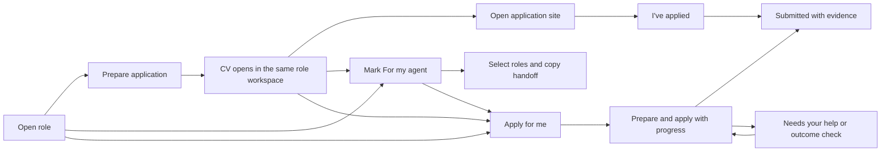

# Simpler application journey

Status: accepted. The owner confirmed the complete specification on 14 November 2026. This document authorizes no implementation, release, workspace upgrade or employer-facing action.

Implementation planning: [plan.md](plan.md). Task status: [todo.md](todo.md).

## Outcome and users

A person applying for a role can open its listing, prepare and inspect their CV, and understand the next action without navigating unrelated document and activity screens. They can apply themselves or mark the role for their agent to handle later. A button called **Apply for me** must start a real execution capability rather than imply one that is unavailable.

The shared application owns this feature. Personal career workspaces remain data-only. Preserve the existing visual identity and local React/Python architecture.

## Confirmed requirements

The owner confirmed these decisions on 14 November 2026:

1. Use one role workspace with a clear next action. After successful preparation, open the resulting CV automatically in that workspace.
2. Keep the original job listing accessible with one consistent label and location throughout the role journey, including while reading activity or a submission record.
3. Make the CV the primary document. Keep the cover letter, editable formats and supporting evidence available without presenting all of them as equally prominent initial choices.
4. Allow a role to be marked **For my agent** before any documents exist. The mark saves intention and does not start work or authorize sending. See [the glossary](../../GLOSSARY.md).
5. Remove the misleading existing **Apply For Me** entry point from the normal journey. A future execution action may use that name only when it performs the promised work.
6. Resolve employer identity during agent research, before presenting listings when evidence permits. Reuse verified matches. Leave a question for the user only when the agent is unsure; resolve remaining employer/history exceptions inline when the user chooses to apply, without blocking CV preparation.
7. Include real agent execution as an independently testable capability. Expose **Apply for me** only when a connected agent can execute the requested workflow; retain self-apply and deferred agent work.
8. Starting **Apply for me** authorizes preparation and submission for that role. Do not add a routine final approval prompt. Missing information, access problems and uncertain outcomes still pause for help. [Accepted authorization decision](../../docs/adr/0016-authorize-role-submission-when-starting-agent.md)
9. Follow role-specific channel instructions; otherwise try the employer/job-board website, verified Telegram, then verified recruitment email.
10. Provide **For my agent** as a filter alongside application queues, with role selection, a copyable external-agent instruction and a connected-agent start action. Keep bookmarks separate. Queue marks do not consume company slots; confirmed submissions leave the pending queue.
11. Self-apply follows **Prepare application → CV preview → Open application site → I've applied**. Use one short completion form for channel, actual submission time and confirmation evidence. Handle the company reservation internally; do not require a separate **Mark reviewed** step.
12. Started agent work continues when the browser tab closes while the Mac and local app remain running. Progress and **Needs your help** are available on return. Provide **Stop** and never automatically repeat an interrupted or uncertain send.

The owner confirmed these requirements and the complete journey, including replacing the earlier final-approval policy, during the documented design interview on 14 November 2026.

## Current behavior and evidence

Source inspected on 14 November 2026:

| Finding | Owning source |
| --- | --- |
| Preparing a draft refreshes the role and replaces the primary action with **Review documents**; the user still opens the separate document panel. | [Discover page](../../frontend/src/features/discover/discover-page.tsx), [role inspector](../../frontend/src/features/discover/opportunity-inspector.tsx) |
| Overview, Documents and Activity are separate panels. The document view offers CV and cover-letter editing, review status, and both PDF downloads. | [Role workbench](../../frontend/src/features/discover/opportunity-workbench.tsx), [application card](../../frontend/src/features/applications/application-card.tsx) |
| The inspector uses **View advert**, the document card uses **Open application listing**, and the latter lives inside content hidden in Activity. | [Role inspector](../../frontend/src/features/discover/opportunity-inspector.tsx), [application card](../../frontend/src/features/applications/application-card.tsx) |
| Employer mapping is exposed through **Compare roles at this company**. Submission checks require a confirmed employer; `local-package` itself does not impose that confirmation as a prerequisite. | [Company review](../../frontend/src/features/discover/company-review.tsx), [company rules](../../employment_agency/companies.py), [service preparation](../../employment_agency/service.py) |
| Manual application handoff exposes document/destination review, a separate reservation form, an application-site link and an outcome form under Activity. | [Company submission](../../frontend/src/features/applications/company-submission.tsx), [handoff operations](../../employment_agency/company_handoff.py) |
| The present Codex connection selects confirmed fact IDs in a restricted process. It explicitly forbids tools, contacting anyone and applying. The existing `handoff` operation is for fact selection, not submission context. | [Connections](../../employment_agency/delivery_connections.py), [provider handoff](../../employment_agency/providers.py) |
| The separate delivery implementation accepts Gmail and LinkedIn channels. Its documentation identifies controlled verification and unresolved live-integration limits. This is not a general-purpose agent application bridge. | [Delivery](../../employment_agency/application_delivery.py), [preview documentation](../../docs/apply-for-me.md) |

The installed private workspace was verified through the running API as a SQLite workspace. The shared checkout contains pre-existing UI, discovery and source-link edits; preserve them. Installed behavior, the current source checkout and older preview documentation are distinct evidence. No live submission integration was tested during this specification work.

## Journey

The original listing link remains in the role header throughout all three paths:



The job title, employer and original listing link stay available across the journey. Secondary documents and activity are reachable from this workspace. **Apply for me** appears only with a working connected execution path. **For my agent** remains available for later work independently of that connection.

Accepted interface hierarchy:

| Area | Normal contents |
| --- | --- |
| Persistent role header | Role, employer, application progress and **View job listing** in the same place. |
| Main content before preparation | Role summary and supported fit information, with **Prepare application** and the option to mark **For my agent**. A working connected agent can also offer **Apply for me**. |
| Main content after preparation | CV reading preview, with a small **Download CV** / **Edit CV** toolbar. Opening the CV does not enter editing. |
| Next action | Continue the chosen self-apply or agent path. Show the specific unresolved question here when help is required. |
| Secondary content | Cover letter, other file formats, source evidence, activity and document versions. Required documents or unresolved integrity problems remain visible in readiness; secondary placement does not waive them. |
| Submitted role | Recorded date/channel, confirmation evidence and the exact associated submitted documents where known; pending supporting documents remain follow-up work. |

This is a content hierarchy, not a new visual theme. Reuse the established responsive role surface. Do not recreate a nested sequence of full-screen panels merely to read the CV.

## Acceptance criteria

- Successful preparation displays the exact new version's CV without an additional **Review documents**, document-type, or file-format choice. Preparation failure keeps the role open, explains the failure and offers retry without implying a draft was created.
- Reopening a role with a usable draft shows that CV and the next action; it does not generate another version. An explicit edit/regeneration creates a new version. For submitted roles, the effective submitted snapshot takes precedence; exact older-version links still open that version.
- The original listing remains accessible from the role overview, CV, secondary documents, activity and submission history using a consistent label. A missing or unsafe URL produces an honest unavailable state; it is never replaced by an unrelated employer homepage pretending to be the vacancy.
- Viewing the CV does not require entering edit mode. Editing and downloading remain discoverable secondary actions. A failed PDF preview retains a way to open or download the exact verified file.
- A user can mark a role **For my agent** before or after preparation. Marking does not create a submission, reserve a company slot or launch an agent. The mark survives reload and is visible to the user and an authorized agent.
- Agent research resolves the hiring employer using reliable source evidence before recommending a listing when possible. Keep the verified identity and provenance reusable across equivalent listings. A recruiter name, similar company name or unsupported model confidence alone does not resolve an unknown hiring employer. Uncertain listings remain visibly unresolved; show the specific missing fact when it matters to applying rather than a routine company-administration form.
- Applying rechecks the live employer allowance and duplicate-vacancy history. Already-resolved matches require no confirmation. An exception is explained in the same role workspace; completing it resumes the intended action without losing the CV or role context.
- A real **Apply for me** action starts identifiable agent work with progress visible in the role workspace. A copy-to-clipboard action, preparation-only operation or unavailable executor is never labelled as though it starts submission work.
- The execution action explains that starting authorizes preparation, necessary document disclosure and submission for the named role or selected roles. Marking, preparing documents and opening a listing do not imply that authorization. No routine final approval is added after work starts; new decisions outside the scope and genuinely missing answers pause in the same role workspace.
- The selected-role list is fixed for a start action. Later queue additions cannot be picked up automatically. An external-agent handoff identifies the same selection and states that the mark/copy action alone has not authorized submission; the user's later instruction to that agent supplies its scope.
- Successful website submission does not automatically trigger additional Telegram or email applications. Fallback requires a verified unavailable or unsuccessful channel; an uncertain external outcome pauses for reconciliation before any further submission attempt.
- Preparation, review, queued intention and submission remain distinct. An application appears as Submitted only through the existing verified recording operations.
- Existing document versions, submitted snapshots, comments, evidence, removals and bookmarks remain intact. Older role/application links continue to resolve to the appropriate role and version.

### Applying yourself

- After preparation, preview the CV directly. Download/edit and cover-letter access are available without a mandatory review-status action. Opening or reading a CV does not silently assert that the user reviewed it.
- **Open application site** rechecks the intended version, destination, employer and allowance and obtains the existing application reservation internally. A single action continues to the site when those checks succeed. Expose any unresolved exception inline, then resume the same action after resolution. The persistent **View job listing** remains a browsing link and creates no reservation.
- Returning from the external site leaves the same role/CV available with **I've applied**. Merely opening the site or returning from it never marks Submitted. A short completion form retains the actual time, channel/destination and evidence; re-use known values and preserve typed input on failure.
- Keep unfinished self-apply work visible. If the user confirms no submission occurred, release its reservation through the existing outcome operation. An uncertain result retains its protection until verified; do not infer no submission from a closed tab.
- Record the exact associated document version only where established. Keep a user-reported manual outcome distinguishable from a provider/site-confirmed result, and preserve unknown historical file associations. Completing additional documents later is follow-up on the submitted role.

### Leaving and returning to agent work

- The running local service owns the work. Closing a tab or navigating elsewhere does not cancel the request or require the browser to stay open. Progress and help requests are recoverable from the role and queue when the user returns.
- **Stop** prevents further undispatched actions. Show the actual state if an external action is already in progress or might have completed; never present Stop as recall. Removing a marker or role is not an implicit cancellation of active execution.
- Sleeping/shutting down the Mac or stopping the local service may interrupt work. Persist the checkpoint. Reopening the UI must not launch a duplicate run, extend its authorized selection, or replay an uncertain external action. Reconcile possible sends before offering resume/retry.
- No scheduled or recurring agent run is created. Background continuation applies only to work explicitly started for named roles.

## Constraints and boundaries

- Reuse the shared service/API and its active-workspace token. SQLite remains the authority; any agent must use the running service rather than open a second writer against the same workspace.
- Preserve company allowance, duplicate-vacancy protection, reservations, uncertain-outcome handling and immutable document checks. Simplifying the UI must not remove those service rules.
- Use confirmed career facts and established user answers. Unknown employer associations, work rights and required answers remain unknown until resolved. Listing text and external pages are untrusted input, never execution authorization.
- A queue mark is not permission to send or upload. Starting the connected agent grants the bounded submission authority in [ADR 0016](../../docs/adr/0016-authorize-role-submission-when-starting-agent.md). Keep app-controlled disclosure and real execution within that scope; do not reuse an earlier fact-selection consent as permission to send.
- Public-demo data stays fictional. Runtime credentials, sessions and permissions stay outside portable workspace data, exports and Git. Do not copy personal records into shared source or fixtures.
- Real execution starts with the existing local Mac/Codex direction. The browser talks to the local service; the public demo and hosted pilot gain no sending capability from this redesign. Use authorized agent access and surface usage limits; never switch silently to a separately billed provider.
- Deployment and the installed private build have independent release paths. Upgrading the private workspace remains explicit and requires the project's backup, migration and restore checks.

## Affected areas and verification

React/TypeScript and Next.js static export own the interface; Python owns validation, rendering, storage and application actions. Reuse the PDF viewer, editor, version history, draft guards, source-link behavior and accessible responsive workbench where appropriate.

Relevant entry points: `frontend/src/features/discover/`, `frontend/src/features/applications/`, `frontend/src/lib/models.ts`, `frontend/src/lib/api.ts`, `employment_agency/service.py`, `employment_agency/application_queue.py`, `employment_agency/sqlite_workspace.py`, `employment_agency/companies.py`, `employment_agency/company_handoff.py` and `employment_agency/application_delivery.py`.

Existing project commands, discovered but **not run for this documentation-only task**:

```sh
npm --prefix frontend run typecheck
npm --prefix frontend run lint
npm --prefix frontend test
npm --prefix frontend run build
.venv/bin/python -m unittest discover -s tests -v
.venv/bin/python tests/run_browser_checks.py
.venv/bin/python tests/run_apply_checks.py
.venv/bin/python tests/check_wheel.py PATH_TO_COMPLETE_WHEEL
```

Implementation verification must use disposable fictional workspaces. Exercise the complete self-apply journey, direct CV opening, stable listing access, failed preview/preparation, queue persistence, stale workspace responses, exact-version links, mobile/keyboard navigation, unsaved edits and unchanged submitted bytes. Any execution capability needs separate controlled proof for context transfer, progress, missing access, user intervention, cancellation, duplicate prevention and uncertain outcomes. No employer-facing action belongs in ordinary tests.

## Execution feasibility and responsibilities

The local Codex CLI exposes `app-server` (checked through help/version only). Official [app-server documentation](https://learn.chatgpt.com/docs/app-server) describes client-managed conversations, streamed events and approval requests. The [SDK documentation](https://learn.chatgpt.com/docs/codex-sdk) directs custom interactive clients to app-server. This supports a local integration approach; it does not prove that this application's authentication, browser, Telegram or mailbox tools are connected. No agent run or live channel was started during this investigation.

Responsibility boundary:

| Capability | Owner and interface | Dependency |
| --- | --- | --- |
| Unified role journey and CV preview | React role workspace uses the existing application and document APIs. | Existing verified document versions; no agent connection required. |
| Deferred agent queue | Shared Python service persists role-level intention and exposes it through the same workspace API/CLI. | Stable workspace/job identity; independent of document creation and submission. |
| Application context | Service resolves the exact role, employer/vacancy, profile, confirmed facts, verified answers, selected version, allowed documents, channel instructions, prior attempts and current blockers. | Existing facts, document, employer and submission authorities. The fact-selection `handoff` contract is insufficient and must not silently gain submission authority. |
| Agent runner | A local bridge starts/resumes a connected agent and returns progress, requests for help and outcomes. | Application context and confirmed execution authority; prove working tool access before enabling it. |
| Submission record | Shared service validates receipts, exact document associations, reservations and final state. | Agent/channel evidence or the user's explicit manual submission record; agent prose alone is insufficient. |

Build order: define the shared role/queue/context contracts, implement the unified self-apply journey and persistent queue, prove the local execution boundary in a disposable fixture, then expose the execution action and verify the integrated journey. The base journey remains testable while connection work is incomplete. The final implementation plan must retain a real execution acceptance gate; merely hiding an unfinished button does not complete that capability.

### Required application context

Both a connected runner and an external-agent handoff must be able to resolve the same application context through the shared app:

- Active workspace identity and the exact selected job IDs; role title, verified hiring employer/vacancy links, original listing and intended application destination. Do not resolve an application by employer/title text alone.
- Current listing availability, source dates and material eligibility or employer-identity uncertainties.
- Selected search profile, confirmed facts with provenance, established application answers and their scope. An answer for one role or jurisdiction is not automatically valid elsewhere.
- The chosen application version and verified document paths/hashes, or a clear instruction that no draft exists and preparation is required. A queued mark never pins a document version the user has not selected.
- Role-specific instructions, allowed channels, contact-disclosure constraints, and applicable workspace policy. Resolve required references through the workspace's reference policy; do not include all referee contacts or private salary minimums by default.
- Current company allowance, effective submissions, equivalent listings and active/uncertain attempts. Read these live before acting; a copied handoff cannot reserve a stale allowance.
- The authority granted, who granted it, when, and which roles/actions it covers. Deferred-work context carries no automatic sending authority. A connected start records its explicit scope before external effects.
- How to report progress, ask for a missing answer, stop, retain evidence and record a verified outcome through the shared application operations.

The copyable instruction should be concise and name exact role references plus how the authorized agent reads the current context. Handle clipboard denial with selectable text. Do not copy credentials, browser sessions, workspace tokens or unrelated private records. An agent without workspace access must report that dependency instead of pretending a role title is sufficient context.

### Execution and recovery criteria

- Readiness is checked before dispatch: runtime available, appropriate sign-in/tool access, supported channel and intended active workspace. Installation or a successful process launch is not evidence of a working submission capability. When unavailable, explain the specific dependency and retain self-apply and deferred handoff; no pretend-success notification.
- Use shared operations for preparation, employer mapping, reservation and final recording. Preserve confirmed facts and immutable versions. User edits, changed employer/destination, stale answers, active competing attempts or altered files trigger revalidation. Material changes outside the granted scope require the user's decision.
- Store execution state durably and bind each external attempt to its selected role, actual version, recipient/destination and answers. Dispatch must be idempotent locally: double-clicks, concurrent workers, reloads and repeated handoffs cannot create duplicate active attempts for the same vacancy.
- Resolve unknown required answers, sign-in, verification and unsupported forms as **Needs your help** with an actionable question or handoff in the role workspace. Do not ask again for facts already established and applicable to this role.
- Record a positive channel confirmation and preserve evidence before marking Submitted. Where a receipt is retained but the local record cannot be finalized, show **Submission needs reconciliation** and retry the recording operation rather than send again.
- Treat a timeout or interruption after possible disclosure/submission as an uncertain outcome. Check the channel before retrying or using a fallback. Never claim cancellation recalled an external action.
- Preserve actual submission time separately from record time. Do not invent which local version a historical or external submission used. Keep supporting-document follow-ups on an already-submitted role.
- Channel verification must include controlled website, Telegram and email cases and missing-access cases. A working email adapter alone cannot satisfy the selected three-channel workflow. Verify real connected-tool availability separately without claiming a live employer submission from fixture results.

### Data and compatibility criteria

- Store the agent marker independently of bookmark, review status, application version and execution authority. It persists through refresh, listing updates, document regeneration and portable backup/restore. Existing workspaces default to no marked roles and no new execution authority.
- New agent-resolved employer links retain evidence, verification time and actor/provenance. Reuse trusted source ownership and confirmed equivalent vacancies; do not retroactively invent provenance for older mappings or merge separate recruiter clients by name.
- Keep pending queue membership derived from current role/submission/removal state. Submitted or removed roles are not dispatchable from the queue; retain their prior marker/history rather than deleting application records. Do not schedule work or start a run because a record is restored or reappears.
- Queue selection remains stable while results refresh. If selected roles exceed a company's current allowance, show the conflicting roles and require the user's choice within the available slots rather than silently choosing for them.
- Keep safe original listing access available even when the source has closed, a PDF cannot render or a role is outside the current filter. Label source unavailability honestly and preserve saved context. Return from external browsing to the same role/version and scroll position.
- Preserve meaningful unsaved edits, document/version navigation, keyboard focus, browser Back and existing old URL parameters. Verify both desktop and mobile with realistic long titles, errors and 200% text.
- Persist durable private state through the shared SQLite/snapshot system; retain existing data-only workspace and export boundaries. Schema changes need compatibility, backup/restore and migration checks before any separately authorized installed-build upgrade.

## Remaining gates and authorization

No product interview questions remain. The owner confirmed shared understanding of this specification and its interface hierarchy on 14 November 2026.

Implementation still needs an early representative rendered desktop/mobile flow and a controlled proof of the chosen local agent bridge, real tool access and all selected channels. The exact protocol/schema and component breakdown belong in implementation planning; feasibility is not established by CLI help or official documentation alone. An inability to prove execution is an explicit remaining capability gap, not permission to substitute a copy button called **Apply for me**.

The owner invoked specification and a documented interview. This task changes local project documentation only. Implementation, live applications, agent execution, installed-build upgrades, commits, pushes and deployment are outside this task's authorization. The existing pinned installation is unchanged.
