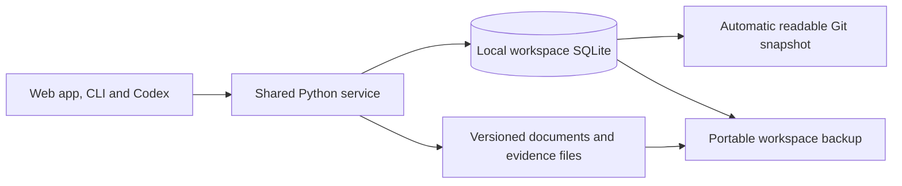

# SQLite workspaces and company application limits

## Outcome

Use one SQLite database per local career workspace. Employment Agency should remember which companies the applicant has applied to, let them compare matching vacancies, and pause discovery and new submissions for three months after two distinct applications to the same employer. The web app, CLI and Codex use the same application rules.

Every saved change to database records automatically updates a readable snapshot for private Git. App code writes small files by record, so editing one application produces a focused diff even as the workspace grows.

## Current behavior

- The local backend loads and atomically rewrites the entire `state.json` document under a workspace lock. Optional delivery attempts and receipts are written separately. The backend and frontend both derive aspects of queue membership from application versions, job tags and corrections. [Workspace storage](../../employment_agency/store.py) · [Submission handling](../../employment_agency/service.py) · [Delivery journal](../../employment_agency/application_delivery.py) · [Application queues](../../frontend/src/features/applications/queues.ts)
- Listing IDs are derived from URLs, and the source adapter uses a board identifier as the employer label. Two listings can represent the same vacancy, and an employer can appear under several labels. Existing matching already ranks opportunities against career facts, search preferences and hard constraints. [Source adapters](../../employment_agency/sources.py) · [Matching](../../employment_agency/matching.py)
- The hosted pilot restores a temporary workspace from a portable archive and publishes a revision to Supabase. The public showcase is a separate static app. The SQLite cutover applies to the local product, including phones accessing its server over Tailscale. [Hosted pilot storage](../../docs/hosted-pilot.md#storage-decision) · [Public showcase decision](../../docs/adr/0013-public-showcase-listings-and-tab-local-drafts.md)

## Data ownership and interfaces



- **Live records.** `workspace.sqlite3` in the selected workspace owns structured records and decisions after cutover. Use Python's `sqlite3`, ordered schema migrations and a small data-access layer for queries and transactions. Keep company policy, matching and submission approval in the shared service. Keep the current HTTP and CLI contracts during migration, then add focused read operations for company roles and queue pages. Codex uses those operations and the guarded submission handoff. [Python sqlite3](https://docs.python.org/3.11/library/sqlite3.html)
- **Documents and settings.** The workspace folder owns `workspace.json`, master résumé sources, canonical application versions, manifests and original evidence artifacts. SQLite stores their relative references, identifiers, hashes and structured outcomes. Submitted document bytes and provenance remain immutable. Machine permissions, browser sessions and credentials use the existing host-local boundaries. [Workspace and document decisions](../../docs/adr/0002-authoritative-workspace-files.md) · [Edit and migration decisions](../../docs/adr/0003-reconcile-edits-and-preserve-migration-history.md)
- **Relational model.** Give employers, employer aliases, vacancies, source listings, application versions, decisions and submission attempts stable keys. Preserve existing job and application IDs used by the app and CLI. Several listings can point to one vacancy, and several application versions and attempts can refer to that vacancy. Store when an application occurred separately from when the app recorded it. Persist the active company review round and its cooldown deadline. Compute slots from effective submissions and active reservations within the round. Use one row per durable entity for the rest of the live state. Preserve sparse or historical fields as versioned data where they have no query or constraint yet.
- **Transactions.** Enforce foreign keys on each connection and use unique constraints for verified source identities and attempt IDs. Use `BEGIN IMMEDIATE` to check current eligibility and reserve the slot in one short write transaction. Commit a confirmed outcome, queue decision and any new cooldown together. Keep network calls and document rendering outside write transactions. Retain the workspace lock for migration and coordination of file operations. Handle SQLite contention with bounded retries of local transactions. [SQLite transactions](https://www.sqlite.org/lang_transaction.html) · [SQLite foreign keys](https://www.sqlite.org/foreignkeys.html)
- **File recovery.** Publish a complete version folder with its verified manifest before exposing its database reference. If the database commit fails, surface the orphaned folder for recovery through application history. A missing or changed file produces the existing integrity warning and blocks approval of that version. [Version publishing](../../employment_agency/packages.py)

## Automatic private Git snapshots

Generate the snapshot in ordinary application code as part of saving a durable change. Record the changed record IDs in the same SQLite transaction as the change. After commit, atomically replace the affected JSON files and publish the snapshot revision and integrity digest in a small manifest last. The digest covers the exact file set and contents. Reuse existing IDs in paths such as `state/jobs/<job-id>.json`, `state/application-versions/<version-id>.json` and `state/employers/<employer-id>.json`. Give growing collections such as comments and events their own record files. Keep stable serialization and ordering so equivalent data produces identical bytes.

- Use a small `state.json` manifest with a format version distinct from legacy `state.json` schemas. A normal save updates the affected records and manifest. A full snapshot can be reconstructed deterministically from SQLite. The exporter owns the generated files and leaves canonical document files alone.
- Surface **Saved locally · snapshot pending** if publication fails after the database commit. Retain the pending changes and retry on reopening or saving again. A valid manifest describes a complete revision. A crash or partial Git commit produces a detectable mismatch. Show snapshot freshness and validation in Settings and through the CLI.
- Detect a changed snapshot pulled from Git or edited outside the app and show a conflict before overwriting it. Offer a verified restore into a new workspace so the user can inspect it alongside their current one. Existing SQLite records remain authoritative for an open workspace. A clean clone can restore explicitly from a complete readable snapshot. Concurrent editing across independent clones is outside this release.
- Keep live SQLite files, journals and temporary files out of Git. The app writes files and reports their status. Git staging, commits and pushes stay user-controlled. The snapshot contains private career data and belongs in a private workspace. It excludes credentials, sessions and machine permissions.

## Company review and cooldown

1. **Resolve the employer and vacancy.** Map a verified employer-owned careers source, ATS board or confirmed alias to the hiring employer. Use the employer's requisition identifier or verified listing equivalence to group postings. Shared names, job boards and similar titles alone leave the identity unresolved. Ask for a mapping before application if the employer or vacancy could change the allowance. Keep separate hiring employers separate by default.
2. **Compare matching roles.** From a listing, **Compare roles at this company** checks supported employer sources and combines those results with imported listings. Show the distinct open roles that fit, with source coverage, last check, evidence, gaps and unknowns. The user chooses one or two within the remaining allowance. Saving and drafting consume zero slots. A chosen role still requires approval of its exact documents and destination before submission. [Submission approval decision](../../docs/adr/0005-explicit-approval-for-external-application-actions.md)
3. **Count actual applications.** A confirmed submission or a valid **Already submitted** record uses one slot per distinct vacancy. Multiple versions or channels for the same vacancy use a single slot. A rejection after an actual submission still counts. An audited correction changes the effective count only when it establishes that the role was never submitted, preserving the original record. Reconcile prior submissions using available evidence and the actual submission date. Flag unresolved dates or identities where they could affect the allowance.
4. **Reserve before the external action.** Check the cooldown before employer-facing preparation, including document uploads. Recheck the employer, vacancy, allowance and exact approval when authorizing a controlled send or handing it off for manual completion. Reserve the slot against the stable attempt ID in SQLite. Retries of the approval reuse the attempt. An uncertain send holds the slot through restarts until the outcome is reconciled. Record independently sent applications in history, including any over-limit application. The app enforces the cap for actions routed through it.
5. **Pause after two.** Set the deadline to three calendar months from the second distinct confirmed submission in the workspace time zone, using the actual submission time. A second submission on 12 November makes the employer eligible again on 12 February at the corresponding local time. Use the last day of the target month if the original day is absent. For a verified date without a time, assume local midnight and reopen at the start of the matching date. One submitted role leaves one slot available. The user can select **Pause this company** after one submission to start the same three-month pause at that point.
6. **Apply the pause throughout discovery.** Skip employer-specific fetches for a paused employer. Exclude its known listings from general search results, Recommended, All roles and automated drafting queues. Apply the same filter to app-managed agent discovery. Show the deadline with the employer's history and on existing saved roles or drafts. Recheck the guard for queued work and at final submission. At the deadline, the next search can include the employer and a new review round offers up to two new vacancies. Prior applications remain visible in Submitted and history.

## Employers to skip in agent research

Before opening an employer source, the agent queries the active local SQLite workspace through `company-avoid`. A company belongs on the list after two distinct confirmed submissions while the latest submission is still within the configured cooldown. With submissions on 1 January and 1 March 2026 and a three-month cooldown, the employer becomes eligible again on 1 June 2026. Confirmed versions, receipts, Already submitted tags and linked historical decisions can establish a submission. Count each verified vacancy once across postings, versions and channels. Drafts, unresolved sends and audited corrections contribute zero.

The lookup returns the workspace and the employer's verified identity, aliases and cooldown deadline. A lookup failure is reported before research proceeds. Expiry opens two fresh slots. A distinct confirmed submission during an active cooldown recalculates the deadline from that submission. Keep the later deadline if the new calculation falls earlier because of a short month or repeated local hour. Preserve the original evidence for older date-only records and use 12:00 am in the workspace timezone, labelled as assumed. Record actual date and time for new submissions. [Accepted decision](../../docs/adr/0015-use-active-cooldowns-for-company-research.md)

## Company research and Discover

- Research five eligible hiring employers when enough can be verified. Start from a company the user has never applied to and inspect its official careers site or employer-owned boards. Follow available listings to completion, deduplicate verified requisitions and report blocked or partial sources. Confirmed history can affect whether a company qualifies. Use eligible employers with earlier submissions only if there are too few first-time employers with qualifying roles. Leave unclear past employer matches pending verification.
- Show every open role that passes the selected profile’s hard requirements, with no per-company result cap. Rank within each company using confirmed career evidence. Keep plausible roles with uncertain work rights, salary or other eligibility visibly flagged. Keep vacancies with confirmed hard conflicts out of the research shortlist. Use fewer companies when there is insufficient evidence to fill five.
- Group Discover opportunities by hiring employer across locations. Keep the role’s location visible, retain location filtering and open each role in the existing inspector. Preserve the meaning of Saved, Active, Submitted and Removed. Group confirmed aliases together and keep distinct verified employers separate when their display names match.
- Use existing public source retrieval and shared application operations. Record source coverage and checked dates. Keep draft generation, paid requests and employer-facing actions separate from research.

Verification covers the two-submission boundary, latest-date expiry, duplicate submissions, employer identity, SQLite upgrade and restore, all eligible roles beyond an arbitrary per-company count, and company grouping and inspector navigation on desktop and mobile widths.

## Other workflows SQLite can simplify

| Order | Workflow | Change and acceptance |
| --- | --- | --- |
| 1 | Application queues and history | Query the effective submission, current version, archive status and removal history once in the backend. Return consistent Saved, Active, Submitted and Removed results with stable ordering and pagination. Compare queue membership, correction behavior and document links against legacy fixtures before switching clients. |
| 2 | Employer sources and discovery | Store source identity and refresh status with the listings. Apply a completed board refresh as a batch and deduplicate verified source postings. A failed or interrupted refresh keeps the previous complete results. Use indexed filters before the existing evidence-based ranker and fetch detailed matches as needed. |
| 3 | Requirement evidence | Store fact links to requirements directly. Save a skill confirmation and its link together, reusing the existing skill equivalence rules. Concurrent confirmations create one reusable skill, distinct written examples retain their provenance, and retiring a fact removes its active match on other listings. |
| 4 | Draft preparation runs | Store each queued job and its progress in a run item. Record budget reservation and provider attempt together before an authorized request. Restart from persisted work and surface uncertain requests for review. Check cancellation, spending caps and duplicate prevention with fake providers. |

Add indexes for measured query paths such as employer and vacancy lookup, per-job version history and queue pagination. Keep full-text indexing and analytics as future work when measured queries warrant them. Benchmark the same operations on a current-size fixture and a larger fictional workspace, and verify that paginated list reads avoid scanning unrelated document folders. SQLite serializes writes on one host. A future multi-host product can put the same domain operations behind a server database. [SQLite transaction concurrency](https://www.sqlite.org/lang_transaction.html#read_transactions_versus_write_transactions)

## Migration and release sequence

1. **Establish portable records and parity.** Build the SQLite store, schema upgrades, deterministic snapshot exporter and legacy importer. In a staged copy, ingest supported `state.json` schemas, application metadata, old decision records and delivery journals. Compare counts, IDs, queue memberships, paths and hashes. Preserve ambiguous legacy records with provenance. Replay verified dated submissions to propose current cooldowns and present the proposed employer mappings and unresolved history for review. Exercise both a plain folder and a private Git workspace fixture.
2. **Verify recovery before cutover.** Take a checksummed portable backup and restore it into a separate folder. Verify SQLite integrity and foreign keys, document bytes, effective submission records and original legacy evidence. Keep legacy ZIP imports working. The new ZIP format packages a consistent logical database snapshot with referenced workspace files and verified originals. Apply the existing archive path and resource-limit checks before importing. Version the archive independently of the database and API. Incompatible readers stop with a clear message. Take any private SQLite backup through the connection backup API. [Python SQLite backup API](https://docs.python.org/3.11/library/sqlite3.html#sqlite3.Connection.backup)
3. **Cut over explicitly.** Use the workspace lock and a staged, verified database. Publish the format manifest after the database and initial snapshot pass verification. Preserve a verified pre-upgrade backup and report unresolved employer records. Document how existing CLI and agent workflows read live state and how a clone restores from the new snapshot. After cutover, an earlier build must reject the new format, and an interrupted upgrade must reopen with a single authoritative store or offer recovery. A missing or corrupt database requires explicit recovery from a verified snapshot or backup. After new writes, reconcile decisions and receipts created since the backup, or use a verified lossless rollback.
4. **Release company review and the guard together.** Wire the company view, discovery filtering and transactional reservation into existing entry points. Deliver the later workflow improvements as individually verified changes. Preserve the hosted pilot's current archive path and the public showcase's separation during this local release. A hosted persistence migration, multi-device database synchronization, new employer delivery integrations and unattended application submission are separate projects.

## Acceptance and verification

- On macOS, Windows and Linux, a supported workspace opens with the expected job IDs, profile and career facts, prior decisions, exact document links and preserved submitted versions. A newer or corrupt store fails safely. Switching between workspaces exposes only the selected workspace's data. Restoring an archive or a Git snapshot carries the employer deadlines and application history with permissions reset.
- Two saves affecting different records produce small Git diffs. A crash after the database commit or partway through file publication is repairable on reopening. A full disk, an unwritable snapshot directory, an externally edited file, or a partial snapshot commit has a visible, recoverable result. Verify clone restore and that credentials and database sidecars stay outside Git and portable snapshots.
- Exercise two simultaneous approvals for the last slot, duplicate approval retries, different listing URLs for one requisition, employer aliases, an ambiguous employer, older submissions, manual records and corrected records. Verify cooldown start and expiry using a controlled clock, including a short month and time-zone boundary. Check a failed send, a restart with uncertain delivery and a receipt arriving after interruption.
- Verify that a cooling employer is skipped before a targeted fetch, excluded from broad results, and blocked from new submissions through the app and agent workflow. The user can still inspect saved drafts, original submissions and receipts, and review new vacancies after the deadline. Use fictional profiles, local job sources and fake delivery transports.

### Existing verification commands

These commands were inspected in the repository and were not run for this specification. Use a disposable workspace for development and exercise the SQLite implementation on fixtures.

```sh
python -m pip install .
python -m employment_agency --workspace /path/to/fictional-workspace init
python -m employment_agency --workspace /path/to/fictional-workspace dev
python -m unittest discover -s tests -v
npm --prefix frontend ci --ignore-scripts
npm --prefix frontend run typecheck
npm --prefix frontend run lint
npm --prefix frontend test
npm --prefix frontend run build
```

The local app's development interpreter imports SQLite successfully. The supported package baseline is Python 3.11, and current CI exercises Python 3.13 across the three desktop platforms. Exercise both the minimum supported runtime and current CI when introducing database features. [Python package](../../pyproject.toml) · [CI workflow](../../.github/workflows/check.yml)
